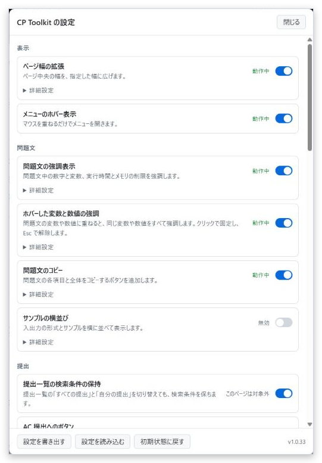

<h1>CP Toolkit</h1>

<strong>27 competitive programming features in one userscript</strong>

View samples side by side, get verdict notifications and jump between tasks on AtCoder. Turn on just the features you want.

<a href="https://greasyfork.org/scripts/603262-cp-toolkit"><strong>Install</strong></a> ・ <a href="https://github.com/nsubaru11/competitive-programming-tools/blob/main/userscripts/CpToolkit/CHANGELOG.md">Changelog (Japanese)</a> ・ <a href="https://github.com/nsubaru11/competitive-programming-tools/blob/main/userscripts/CpToolkit/COMPATIBILITY.md">Using other scripts</a> ・ <a href="https://github.com/nsubaru11/competitive-programming-tools/issues">Bugs and requests</a> ・ <a href="https://github.com/nsubaru11/competitive-programming-tools/blob/main/userscripts/CpToolkit/README.md">日本語</a>

## 1. Installation

1. Install [Tampermonkey](https://www.tampermonkey.net/) in your browser
2. In Chrome and other Chromium-based browsers, turn on "Allow User Scripts" in the Tampermonkey extension details
3. Install the script from its [Greasy Fork page](https://greasyfork.org/scripts/603262-cp-toolkit)

## 2. Usage

Choose "Open settings" in Tampermonkey or "CP Toolkit" in the AtCoder header. Toggle individual features or open their detailed settings. Settings are kept per site. Switch sites with the tabs at the top; each tab lists only the features and settings that work there. A few settings, such as the Local Runner URL, are shared by all sites. If a feature shows "Reload to apply", choose "Reload page" at the bottom.

 The settings opened on an AtCoder task page. Switch the site to configure with the tabs at the top.

Use "Back up settings to a file" at the bottom of the settings to save feature toggles and detailed settings to a file, and "Restore settings from a file" to load them again. The interface is available in Japanese and English.

 Buttons to back up, restore and reset the settings, at the bottom of the feature list.

When a newer version exists, a notice appears once in the corner of the page, and an "Update to" link appears at the bottom right of the settings. Opening the link shows the update page of Tampermonkey. "Check for updates" in the settings checks right away.

## 3. Supported sites

<table>
<thead>
<tr style="background-color: rgba(128, 128, 128, 0.25)">
<th>Site&emsp;</th>
<th>Available features</th>
</tr>
</thead>
<tbody><tr>
<td>AtCoder&emsp;</td>
<td>26 features (all except paiza language selection)</td>
</tr>
<tr style="background-color: rgba(128, 128, 128, 0.1)">
<td>yukicoder&emsp;</td>
<td>Easy Test+, Keyboard shortcuts, Submission helper, Code header and footer</td>
</tr>
<tr>
<td>Codeforces&emsp;</td>
<td>Easy Test+, Keyboard shortcuts, Submission helper, Code header and footer</td>
</tr>
<tr style="background-color: rgba(128, 128, 128, 0.1)">
<td>AOJ, Library Checker&emsp;</td>
<td>Keyboard shortcuts, Submission helper, Code header and footer</td>
</tr>
<tr>
<td>paiza&emsp;</td>
<td>Keyboard shortcuts, Submission helper, paiza language selection, Code header and footer</td>
</tr>
</tbody></table>

## 4. Feature list

All features are enabled from the start, except those marked off by default. Click a feature name to open its detail page.

### 4.1 Layout

<table>
<thead>
<tr style="background-color: rgba(128, 128, 128, 0.25)">
<th>Feature&emsp;</th>
<th>What it does</th>
</tr>
</thead>
<tbody><tr>
<td><a href="https://github.com/nsubaru11/competitive-programming-tools/blob/main/userscripts/CpToolkit/docs/features/wide-layout.en.md"><strong>Wider page</strong></a>&emsp;</td>
<td>Set the width of the main content column.</td>
</tr>
<tr style="background-color: rgba(128, 128, 128, 0.1)">
<td><a href="https://github.com/nsubaru11/competitive-programming-tools/blob/main/userscripts/CpToolkit/docs/features/hover-menu.en.md"><strong>Open dropdowns on hover</strong></a>&emsp;</td>
<td>Hover over your username, the language selector or the Results tab to open its dropdown.</td>
</tr>
</tbody></table>

### 4.2 Statement

<table>
<thead>
<tr style="background-color: rgba(128, 128, 128, 0.25)">
<th>Feature&emsp;</th>
<th>What it does</th>
</tr>
</thead>
<tbody><tr>
<td><a href="https://github.com/nsubaru11/competitive-programming-tools/blob/main/userscripts/CpToolkit/docs/features/efficient-layout.en.md"><strong>Side-by-side samples</strong></a> off by default&emsp;</td>
<td>Show samples side by side, with each pair's width fitted to its contents automatically.</td>
</tr>
<tr style="background-color: rgba(128, 128, 128, 0.1)">
<td><a href="https://github.com/nsubaru11/competitive-programming-tools/blob/main/userscripts/CpToolkit/docs/features/statement-highlight.en.md"><strong>Statement highlighting</strong></a>&emsp;</td>
<td>Highlight numbers, variables, and the time and memory limits in a task statement.</td>
</tr>
<tr>
<td><a href="https://github.com/nsubaru11/competitive-programming-tools/blob/main/userscripts/CpToolkit/docs/features/variable-hover.en.md"><strong>Highlight hovered variables and numbers</strong></a>&emsp;</td>
<td>Hover over a variable or number in a formula to highlight matching occurrences in the same task.</td>
</tr>
<tr style="background-color: rgba(128, 128, 128, 0.1)">
<td><a href="https://github.com/nsubaru11/competitive-programming-tools/blob/main/userscripts/CpToolkit/docs/features/statement-copy.en.md"><strong>Copy statement</strong></a>&emsp;</td>
<td>Copy sections such as the statement and constraints individually or together.</td>
</tr>
</tbody></table>

### 4.3 Submissions

<table>
<thead>
<tr style="background-color: rgba(128, 128, 128, 0.25)">
<th>Feature&emsp;</th>
<th>What it does</th>
</tr>
</thead>
<tbody><tr>
<td><a href="https://github.com/nsubaru11/competitive-programming-tools/blob/main/userscripts/CpToolkit/docs/features/result-notifier.en.md"><strong>Submission notifications</strong></a>&emsp;</td>
<td>Receive a notification when judging finishes.</td>
</tr>
<tr style="background-color: rgba(128, 128, 128, 0.1)">
<td><a href="https://github.com/nsubaru11/competitive-programming-tools/blob/main/userscripts/CpToolkit/docs/features/language-buttons.en.md"><strong>Language switch buttons</strong></a>&emsp;</td>
<td>Pin frequently used submission languages and switch between them with one click.</td>
</tr>
<tr>
<td><a href="https://github.com/nsubaru11/competitive-programming-tools/blob/main/userscripts/CpToolkit/docs/features/source-comments.en.md"><strong>Code header and footer</strong></a>&emsp;</td>
<td>Add a saved header and footer when you paste a complete solution.</td>
</tr>
<tr style="background-color: rgba(128, 128, 128, 0.1)">
<td><a href="https://github.com/nsubaru11/competitive-programming-tools/blob/main/userscripts/CpToolkit/docs/features/submission-shortcuts.en.md"><strong>AC submission buttons</strong></a>&emsp;</td>
<td>Open accepted submissions for a task sorted by runtime, code size, submission time or memory.</td>
</tr>
<tr>
<td><a href="https://github.com/nsubaru11/competitive-programming-tools/blob/main/userscripts/CpToolkit/docs/features/submission-query.en.md"><strong>Keep submission filters</strong></a>&emsp;</td>
<td>Keep search filters when switching between All Submissions and My Submissions.</td>
</tr>
<tr style="background-color: rgba(128, 128, 128, 0.1)">
<td><a href="https://github.com/nsubaru11/competitive-programming-tools/blob/main/userscripts/CpToolkit/docs/features/average-result.en.md"><strong>Test case averages</strong></a>&emsp;</td>
<td>Show average runtime and memory usage across test cases on the submission details page.</td>
</tr>
<tr>
<td><a href="https://github.com/nsubaru11/competitive-programming-tools/blob/main/userscripts/CpToolkit/docs/features/submission-timer.en.md"><strong>Delayed submission</strong></a> off by default&emsp;</td>
<td>Submit the code in the editor after a delay you specify.</td>
</tr>
</tbody></table>

### 4.4 Contest

<table>
<thead>
<tr style="background-color: rgba(128, 128, 128, 0.25)">
<th>Feature&emsp;</th>
<th>What it does</th>
</tr>
</thead>
<tbody><tr>
<td><a href="https://github.com/nsubaru11/competitive-programming-tools/blob/main/userscripts/CpToolkit/docs/features/task-dropdown.en.md"><strong>Tasks dropdown</strong></a>&emsp;</td>
<td>Open a task from the Tasks tab, or open several tasks at once.</td>
</tr>
<tr style="background-color: rgba(128, 128, 128, 0.1)">
<td><a href="https://github.com/nsubaru11/competitive-programming-tools/blob/main/userscripts/CpToolkit/docs/features/task-status.en.md"><strong>Task status colors</strong></a>&emsp;</td>
<td>Color tasks in the task list and the Tasks dropdown according to your submission results.</td>
</tr>
<tr>
<td><a href="https://github.com/nsubaru11/competitive-programming-tools/blob/main/userscripts/CpToolkit/docs/features/editorial-list.en.md"><strong>All editorials</strong></a>&emsp;</td>
<td>Read editorials directly below their links on the editorials page.</td>
</tr>
<tr style="background-color: rgba(128, 128, 128, 0.1)">
<td><a href="https://github.com/nsubaru11/competitive-programming-tools/blob/main/userscripts/CpToolkit/docs/features/tessoku-difficulty.en.md"><strong>Tessoku difficulty</strong></a>&emsp;</td>
<td>Show the difficulty ratings from the book on the Tessoku task list.</td>
</tr>
<tr>
<td><a href="https://github.com/nsubaru11/competitive-programming-tools/blob/main/userscripts/CpToolkit/docs/features/virtual-timer.en.md"><strong>Virtual contest timer</strong></a>&emsp;</td>
<td>See the time until your virtual contest starts and the time remaining once it begins.</td>
</tr>
<tr style="background-color: rgba(128, 128, 128, 0.1)">
<td><a href="https://github.com/nsubaru11/competitive-programming-tools/blob/main/userscripts/CpToolkit/docs/features/clar-notifier.en.md"><strong>Clarification notifications</strong></a>&emsp;</td>
<td>Receive a notification when the organizers post a clarification during a contest.</td>
</tr>
<tr>
<td><a href="https://github.com/nsubaru11/competitive-programming-tools/blob/main/userscripts/CpToolkit/docs/features/contest-calendar.en.md"><strong>Add to calendar</strong></a>&emsp;</td>
<td>Open a Google Calendar event form with the contest name and times filled in.</td>
</tr>
<tr style="background-color: rgba(128, 128, 128, 0.1)">
<td><a href="https://github.com/nsubaru11/competitive-programming-tools/blob/main/userscripts/CpToolkit/docs/features/top-links.en.md"><strong>Contest links on the top page</strong></a>&emsp;</td>
<td>Open the ABC, ARC, AGC and AHC contest archives from the home page.</td>
</tr>
<tr>
<td><a href="https://github.com/nsubaru11/competitive-programming-tools/blob/main/userscripts/CpToolkit/docs/features/latest-contests.en.md"><strong>Next contests</strong></a>&emsp;</td>
<td>View upcoming contests from the header.</td>
</tr>
</tbody></table>

### 4.5 Results

<table>
<thead>
<tr style="background-color: rgba(128, 128, 128, 0.25)">
<th>Feature&emsp;</th>
<th>What it does</th>
</tr>
</thead>
<tbody><tr>
<td><a href="https://github.com/nsubaru11/competitive-programming-tools/blob/main/userscripts/CpToolkit/docs/features/rating-graph.en.md"><strong>Performance on the rating graph</strong></a>&emsp;</td>
<td>Overlay performance from rated contests on a user's rating graph.</td>
</tr>
</tbody></table>

### 4.6 Testing and submission tools

<table>
<thead>
<tr style="background-color: rgba(128, 128, 128, 0.25)">
<th>Feature&emsp;</th>
<th>What it does</th>
</tr>
</thead>
<tbody><tr>
<td><a href="https://github.com/nsubaru11/competitive-programming-tools/blob/main/userscripts/CpToolkit/docs/features/easy-test.en.md"><strong>Easy Test+</strong></a> off by default&emsp;</td>
<td>Run sample tests from the task page and submit when they all pass.</td>
</tr>
<tr style="background-color: rgba(128, 128, 128, 0.1)">
<td><a href="https://github.com/nsubaru11/competitive-programming-tools/blob/main/userscripts/CpToolkit/docs/features/submission-helper.en.md"><strong>Submission helper</strong></a> off by default&emsp;</td>
<td>Prepare pasted code for submission.</td>
</tr>
<tr>
<td><a href="https://github.com/nsubaru11/competitive-programming-tools/blob/main/userscripts/CpToolkit/docs/features/keyboard-shortcuts.en.md"><strong>Keyboard shortcuts</strong></a>&emsp;</td>
<td>Submit, copy samples, switch tasks, open pages and more with keys you choose.</td>
</tr>
<tr style="background-color: rgba(128, 128, 128, 0.1)">
<td><a href="https://github.com/nsubaru11/competitive-programming-tools/blob/main/userscripts/CpToolkit/docs/features/paiza-language.en.md"><strong>paiza language selection</strong></a>&emsp;</td>
<td>Automatically select your preferred language on paiza submission pages.</td>
</tr>
</tbody></table>

## 5. Using other scripts

If two scripts offer the same feature, turn it off in one of them to avoid duplicate buttons or notifications.

[ac-predictor](https://greasyfork.org/scripts/369954), [AtCoderStandingsAnalysis](https://greasyfork.org/scripts/398439) and [atcoder-difficulty-display](https://greasyfork.org/scripts/397185) can run alongside CP Toolkit.

The full list is in [COMPATIBILITY.md](https://github.com/nsubaru11/competitive-programming-tools/blob/main/userscripts/CpToolkit/COMPATIBILITY.md) (Japanese).

## 6. Network access

This script sends nothing to the author's servers. Besides the site you are viewing, it connects to other services only in these cases:

- **Local Runner** receives code for transformation or execution. With precompilation enabled, Easy Test+ also sends code as you edit.
- **PaizaIO and Wandbox** receive code and input when you run code with that service selected. Easy Test+ never switches to either service after an internal error. When loading available environments, it fetches the Wandbox compiler list and caches it for 24 hours.
- **jsDelivr**: KaTeX and Prettify for editorial math and code, Pyodide for running Python in the browser, and AtCoder Library for C++ on Wandbox are fetched only when needed
- **Update checks** fetch version information from GitHub or Greasy Fork, depending on where you installed the script. Automatic checks run once a day. They send no solution code or settings.

KaTeX, Prettify, Pyodide and AtCoder Library are loaded at pinned versions. "Add to calendar" only places a link; the contest details reach Google when you open it.

<b>How often the script accesses AtCoder</b>

<ul>
<li><strong>Submission notifications</strong>: Checks only while you have submissions being judged. The interval follows the site, at least 1 second, and checking stops after 30 minutes. Failed requests increase the polling interval.</li>
<li><strong>Clarification notifications</strong>: Checks once a minute during a contest, but not in the first 5 minutes</li>
<li><strong>Task status colors</strong>: Fetches every page of your submissions in order when you open the task list or open the dropdown for the first time, but not in the first 5 minutes of a contest</li>
<li><strong>Tasks dropdown</strong>: Fetches once per contest and remembers it for 10 days</li>
<li><strong>All editorials</strong>: Fetches only the editorials shown on screen, every 0.5 seconds</li>
<li><strong>Next contests</strong>: Fetches only when you open Next contests and remembers it for 1 hour</li>
<li><strong>Performance on the rating graph</strong>: Fetches once when you open a user page</li>
<li><strong>Easy Test+</strong> fetches samples on the submission page and sends code and input when you run an AtCoder custom test.</li>
</ul>

## 7. Migrating from the old scripts

These scripts have been merged into CP Toolkit. Their final versions are available from the [Release](https://github.com/nsubaru11/competitive-programming-tools/releases/tag/legacy-userscripts-final).

AtCoder Custom Default Submissions, AtCoder Easy Test for Java, AtCoder Highlighter, AtCoder Listing Tasks, AtCoder Markdown Copier, AtCoder Performance Overlay, AtCoder Widen Container, Java Code Submitter, Paiza Language Selector

<b>Migration steps</b>

<ol>
<li>Update the old scripts to their final versions and install CP Toolkit</li>
<li>Open and reload a site where each old script runs. To import paiza settings, do this on paiza as well.</li>
<li>After checking that the settings were carried over, delete the old scripts</li>
</ol>

Imported settings are shared across sites. Settings you already chose in CP Toolkit are preserved.

These settings are carried over:

<ul>
<li><strong>AtCoder Easy Test for Java</strong>: Settings such as precompiling the code being edited, and the Local Runner URL</li>
<li><strong>AtCoder Highlighter</strong>: Highlight colors</li>
<li><strong>AtCoder Widen Container</strong>: Page width</li>
<li><strong>Paiza Language Selector</strong>: The language to select automatically</li>
</ul>

<b>Differences from the old scripts</b>

<ul>
<li>The default filter on the submissions tab has been dropped. Open AC submissions from the AC submission buttons on the task page</li>
<li>Easy Test+ is off by default. It is turned on when you migrate from AtCoder Easy Test for Java</li>
<li>Desktop notifications are shown not only while you view another tab but also while you are away from the browser</li>
<li>Java Code Submitter settings and code saved by the old script are not carried over</li>
<li>Color settings accept only the <code>#rrggbb</code> format</li>
<li>&quot;recent&quot; on the rating graph shows the specified range. The default is the last 20 contests</li>
<li>Shortcuts work only when the modifier keys match exactly</li>
<li>The settings button on the bottom panel of Easy Test+ opens the CP Toolkit settings</li>
<li>On Codeforces, the Easy Test+ buttons are shown without decoration</li>
</ul>

## 8. Source code and license

The distributed code is the TypeScript source bundled into one file, neither obfuscated nor minified. The source is on [GitHub](https://github.com/nsubaru11/competitive-programming-tools/tree/main/userscripts/CpToolkit).

Claude is used in development. The design and specifications were decided by the author.

The bundle includes third-party code and turndown, so its license is `MIT AND Apache-2.0 AND 0BSD`. See [SOURCES.md](https://github.com/nsubaru11/competitive-programming-tools/blob/main/userscripts/CpToolkit/SOURCES.md) for the origin of each feature and [THIRD_PARTY_NOTICES.md](https://github.com/nsubaru11/competitive-programming-tools/blob/main/THIRD_PARTY_NOTICES.md) for third-party licenses.

For development information, see the [development guide (Japanese)](https://github.com/nsubaru11/competitive-programming-tools/blob/main/userscripts/CpToolkit/DEVELOPMENT.md).

For performance measurements compared with the former UserScripts, see the [performance report (Japanese)](https://github.com/nsubaru11/competitive-programming-tools/blob/main/userscripts/CpToolkit/PERFORMANCE.md).

## 9. Bugs and requests

Please use [GitHub Issues](https://github.com/nsubaru11/competitive-programming-tools/issues) or the Greasy Fork feedback page.
