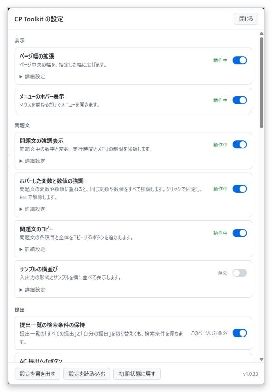

<h1>CP Toolkit</h1>

<strong>A userscript that combines competitive programming helpers into one script</strong>

It focuses on AtCoder and improves the statement, submission, contest and results pages. Every feature can be switched on and off individually.

<a href="https://greasyfork.org/scripts/603262-cp-toolkit"><strong>Install</strong></a> ・ <a href="https://github.com/nsubaru11/competitive-programming-tools/blob/main/userscripts/CpToolkit/COMPATIBILITY.md">Using other scripts</a> ・ <a href="https://github.com/nsubaru11/competitive-programming-tools/issues">Bugs and requests</a> ・ <a href="https://github.com/nsubaru11/competitive-programming-tools/blob/main/userscripts/CpToolkit/README.md">日本語</a>

## 1. Installation

1. Install [Tampermonkey](https://www.tampermonkey.net/) in your browser
2. In Chrome and other Chromium-based browsers, turn on "Allow User Scripts" in the Tampermonkey extension details
3. Install the script from its [Greasy Fork page](https://greasyfork.org/scripts/603262-cp-toolkit)

## 2. Usage

Open the settings from "Open settings" in the Tampermonkey menu, or from "CP Toolkit" in the AtCoder header. Each feature can be switched on and off there. Some features can be adjusted further in their detailed settings.

The interface follows the language of the site and is available in Japanese and English.

## 3. Supported sites

<table>
<thead>
<tr style="background-color: rgba(128, 128, 128, 0.25)">
<th>Site&emsp;</th>
<th>Available features</th>
</tr>
</thead>
<tbody><tr>
<td>AtCoder&emsp;</td>
<td>Every feature except paiza language selection</td>
</tr>
<tr style="background-color: rgba(128, 128, 128, 0.1)">
<td>yukicoder&emsp;</td>
<td>Easy Test+</td>
</tr>
<tr>
<td>Codeforces&emsp;</td>
<td>Easy Test+, Java submission helper</td>
</tr>
<tr style="background-color: rgba(128, 128, 128, 0.1)">
<td>AOJ, Library Checker&emsp;</td>
<td>Java submission helper</td>
</tr>
<tr>
<td>paiza&emsp;</td>
<td>Java submission helper, paiza language selection</td>
</tr>
</tbody></table>

## 4. Feature list

All features are enabled from the start, except those marked off by default. Click a feature name to open its detail page.

### 4.1 Layout

<table>
<thead>
<tr style="background-color: rgba(128, 128, 128, 0.25)">
<th>Feature&emsp;</th>
<th>What it does</th>
</tr>
</thead>
<tbody><tr>
<td><a href="https://github.com/nsubaru11/competitive-programming-tools/blob/main/userscripts/CpToolkit/docs/features/wide-layout.en.md"><strong>Wider page</strong></a>&emsp;</td>
<td>Widens the central column to the specified width (75% recommended)</td>
</tr>
<tr style="background-color: rgba(128, 128, 128, 0.1)">
<td><a href="https://github.com/nsubaru11/competitive-programming-tools/blob/main/userscripts/CpToolkit/docs/features/hover-menu.en.md"><strong>Open menus on hover</strong></a>&emsp;</td>
<td>Opens menus when the pointer moves over them</td>
</tr>
</tbody></table>

### 4.2 Statement

<table>
<thead>
<tr style="background-color: rgba(128, 128, 128, 0.25)">
<th>Feature&emsp;</th>
<th>What it does</th>
</tr>
</thead>
<tbody><tr>
<td><a href="https://github.com/nsubaru11/competitive-programming-tools/blob/main/userscripts/CpToolkit/docs/features/statement-highlight.en.md"><strong>Statement highlighting</strong></a>&emsp;</td>
<td>Highlights numbers, variables, and the time and memory limits</td>
</tr>
<tr style="background-color: rgba(128, 128, 128, 0.1)">
<td><a href="https://github.com/nsubaru11/competitive-programming-tools/blob/main/userscripts/CpToolkit/docs/features/variable-hover.en.md"><strong>Highlight hovered variables and numbers</strong></a>&emsp;</td>
<td>Hovering a variable or a number highlights every occurrence of it</td>
</tr>
<tr>
<td><a href="https://github.com/nsubaru11/competitive-programming-tools/blob/main/userscripts/CpToolkit/docs/features/statement-copy.en.md"><strong>Copy statement</strong></a>&emsp;</td>
<td>Copies each section or the whole statement as Markdown or plain text</td>
</tr>
<tr style="background-color: rgba(128, 128, 128, 0.1)">
<td><a href="https://github.com/nsubaru11/competitive-programming-tools/blob/main/userscripts/CpToolkit/docs/features/efficient-layout.en.md"><strong>Side-by-side samples</strong></a> off by default&emsp;</td>
<td>Places the input and output formats and samples side by side</td>
</tr>
</tbody></table>

### 4.3 Submissions

<table>
<thead>
<tr style="background-color: rgba(128, 128, 128, 0.25)">
<th>Feature&emsp;</th>
<th>What it does</th>
</tr>
</thead>
<tbody><tr>
<td><a href="https://github.com/nsubaru11/competitive-programming-tools/blob/main/userscripts/CpToolkit/docs/features/submission-query.en.md"><strong>Keep submission filters</strong></a>&emsp;</td>
<td>Keeps search filters when switching between All and My submissions</td>
</tr>
<tr style="background-color: rgba(128, 128, 128, 0.1)">
<td><a href="https://github.com/nsubaru11/competitive-programming-tools/blob/main/userscripts/CpToolkit/docs/features/submission-shortcuts.en.md"><strong>AC submission buttons</strong></a>&emsp;</td>
<td>Opens the AC submissions for the task, sorted by time, code size, submission time or memory</td>
</tr>
<tr>
<td><a href="https://github.com/nsubaru11/competitive-programming-tools/blob/main/userscripts/CpToolkit/docs/features/language-buttons.en.md"><strong>Language switch buttons</strong></a>&emsp;</td>
<td>Saves your frequently used languages as buttons and switches in one click</td>
</tr>
<tr style="background-color: rgba(128, 128, 128, 0.1)">
<td><a href="https://github.com/nsubaru11/competitive-programming-tools/blob/main/userscripts/CpToolkit/docs/features/source-comments.en.md"><strong>Header and footer</strong></a>&emsp;</td>
<td>Adds comments such as reference URLs to the top and bottom of pasted code</td>
</tr>
<tr>
<td><a href="https://github.com/nsubaru11/competitive-programming-tools/blob/main/userscripts/CpToolkit/docs/features/result-notifier.en.md"><strong>Submission notifications</strong></a>&emsp;</td>
<td>Shows the verdict right after judging finishes, on any page</td>
</tr>
<tr style="background-color: rgba(128, 128, 128, 0.1)">
<td><a href="https://github.com/nsubaru11/competitive-programming-tools/blob/main/userscripts/CpToolkit/docs/features/average-result.en.md"><strong>Test case averages</strong></a>&emsp;</td>
<td>Shows average time and memory on the submission page</td>
</tr>
<tr>
<td><a href="https://github.com/nsubaru11/competitive-programming-tools/blob/main/userscripts/CpToolkit/docs/features/submission-timer.en.md"><strong>Delayed submission</strong></a> off by default&emsp;</td>
<td>Submits your code after the specified time</td>
</tr>
</tbody></table>

### 4.4 Contest

<table>
<thead>
<tr style="background-color: rgba(128, 128, 128, 0.25)">
<th>Feature&emsp;</th>
<th>What it does</th>
</tr>
</thead>
<tbody><tr>
<td><a href="https://github.com/nsubaru11/competitive-programming-tools/blob/main/userscripts/CpToolkit/docs/features/clar-notifier.en.md"><strong>Clarification notifications</strong></a>&emsp;</td>
<td>Notifies you when the organizers post an answer or a correction during a contest</td>
</tr>
<tr style="background-color: rgba(128, 128, 128, 0.1)">
<td><a href="https://github.com/nsubaru11/competitive-programming-tools/blob/main/userscripts/CpToolkit/docs/features/task-dropdown.en.md"><strong>Task dropdown</strong></a>&emsp;</td>
<td>Opens tasks from the Tasks tab and opens several tasks at once</td>
</tr>
<tr>
<td><a href="https://github.com/nsubaru11/competitive-programming-tools/blob/main/userscripts/CpToolkit/docs/features/task-status.en.md"><strong>Task status colors</strong></a>&emsp;</td>
<td>Colors the task list and the dropdown by all your submissions, including those after the contest</td>
</tr>
<tr style="background-color: rgba(128, 128, 128, 0.1)">
<td><a href="https://github.com/nsubaru11/competitive-programming-tools/blob/main/userscripts/CpToolkit/docs/features/editorial-list.en.md"><strong>All editorials</strong></a>&emsp;</td>
<td>Shows the editorials of every task on one page</td>
</tr>
<tr>
<td><a href="https://github.com/nsubaru11/competitive-programming-tools/blob/main/userscripts/CpToolkit/docs/features/top-links.en.md"><strong>Contest links on the top page</strong></a>&emsp;</td>
<td>Replaces the top page list with links to past contests by type</td>
</tr>
<tr style="background-color: rgba(128, 128, 128, 0.1)">
<td><a href="https://github.com/nsubaru11/competitive-programming-tools/blob/main/userscripts/CpToolkit/docs/features/latest-contests.en.md"><strong>Next contests</strong></a>&emsp;</td>
<td>Adds a header menu with the upcoming contests listed on the home page</td>
</tr>
<tr>
<td><a href="https://github.com/nsubaru11/competitive-programming-tools/blob/main/userscripts/CpToolkit/docs/features/contest-calendar.en.md"><strong>Add to calendar</strong></a>&emsp;</td>
<td>Adds a link to contest pages that registers the contest in Google Calendar</td>
</tr>
<tr style="background-color: rgba(128, 128, 128, 0.1)">
<td><a href="https://github.com/nsubaru11/competitive-programming-tools/blob/main/userscripts/CpToolkit/docs/features/virtual-timer.en.md"><strong>Virtual contest timer</strong></a>&emsp;</td>
<td>Shows the time until the start and the time left in the corner clock</td>
</tr>
<tr>
<td><a href="https://github.com/nsubaru11/competitive-programming-tools/blob/main/userscripts/CpToolkit/docs/features/tessoku-difficulty.en.md"><strong>Tessoku difficulty</strong></a>&emsp;</td>
<td>Shows the difficulty from the book on the Tessoku task list</td>
</tr>
</tbody></table>

### 4.5 Results

<table>
<thead>
<tr style="background-color: rgba(128, 128, 128, 0.25)">
<th>Feature&emsp;</th>
<th>What it does</th>
</tr>
</thead>
<tbody><tr>
<td><a href="https://github.com/nsubaru11/competitive-programming-tools/blob/main/userscripts/CpToolkit/docs/features/rating-graph.en.md"><strong>Performance on the user page graph</strong></a>&emsp;</td>
<td>Overlays performance on the rating graph of user pages, with a recent range set by count or percentage</td>
</tr>
</tbody></table>

### 4.6 Execution

<table>
<thead>
<tr style="background-color: rgba(128, 128, 128, 0.25)">
<th>Feature&emsp;</th>
<th>What it does</th>
</tr>
</thead>
<tbody><tr>
<td><a href="https://github.com/nsubaru11/competitive-programming-tools/blob/main/userscripts/CpToolkit/docs/features/java-submit.en.md"><strong>Java submission helper</strong></a>&emsp;</td>
<td>Transforms pasted code for submission and adds submit shortcuts</td>
</tr>
<tr style="background-color: rgba(128, 128, 128, 0.1)">
<td><a href="https://github.com/nsubaru11/competitive-programming-tools/blob/main/userscripts/CpToolkit/docs/features/local-runner.en.md"><strong>Local Runner</strong></a>&emsp;</td>
<td>Connects to the local server used to transform and run code. A server of your own with the same API also works</td>
</tr>
<tr>
<td><a href="https://github.com/nsubaru11/competitive-programming-tools/blob/main/userscripts/CpToolkit/docs/features/easy-test.en.md"><strong>Easy Test+</strong></a> off by default&emsp;</td>
<td>Runs samples from the task page and checks the results</td>
</tr>
<tr style="background-color: rgba(128, 128, 128, 0.1)">
<td><a href="https://github.com/nsubaru11/competitive-programming-tools/blob/main/userscripts/CpToolkit/docs/features/paiza-language.en.md"><strong>paiza language selection</strong></a>&emsp;</td>
<td>Selects the specified language on paiza submission pages. It does nothing until you set a language</td>
</tr>
</tbody></table>

## 5. Using other scripts

Using scripts that duplicate a CP Toolkit feature is not recommended, because buttons and notifications can appear twice. Use only one of the two for each feature. If you keep the other script, turn off the matching feature in the CP Toolkit settings.

Scripts that do not overlap work alongside CP Toolkit as they are, for example ac-predictor, AtCoderStandingsAnalysis and atcoder-difficulty-display.

The full list is in [COMPATIBILITY.md](https://github.com/nsubaru11/competitive-programming-tools/blob/main/userscripts/CpToolkit/COMPATIBILITY.md) (Japanese).

## 6. Network access

This script sends nothing to the author's servers. Besides the site you are viewing, it connects to other services only in these cases:

- **Your Local Runner** (`http://localhost:8080` by default): Your code is sent to your own PC to transform and run it
- **PaizaIO and Wandbox**: Your code and input are sent only when you choose them as the Easy Test+ environment. The script never switches to them automatically
- **jsDelivr**: KaTeX and Prettify for editorial math and code, Pyodide for running Python in the browser, and AtCoder Library for C++ on Wandbox are fetched only when needed

KaTeX, Prettify, Pyodide and AtCoder Library are loaded at pinned versions. "Add to calendar" only places a link; the contest details reach Google when you open it.

<b>How often the script accesses AtCoder</b>

<ul>
<li><strong>Submission notifications</strong>: Checks only while you have submissions being judged. The interval follows the site, at least 1 second, and checking stops after 30 minutes</li>
<li><strong>Clarification notifications</strong>: Checks once a minute during a contest, but not in the first 5 minutes</li>
<li><strong>Task status colors</strong>: Fetches every page of your submissions in order when you open the task list or open the dropdown for the first time, but not in the first 5 minutes of a contest</li>
<li><strong>Task dropdown</strong>: Fetches once per contest and remembers it for 10 days</li>
<li><strong>All editorials</strong>: Fetches only the editorials shown on screen, every 0.5 seconds</li>
<li><strong>Next contests</strong>: Fetches only when you open the menu and remembers it for 1 hour</li>
<li><strong>Performance on the user page graph</strong>: Fetches once when you open a user page</li>
<li><strong>Easy Test+</strong>: Accesses the site only when you run code. AtCoder custom tests run one at a time, even across tabs</li>
</ul>

When a request fails, the script waits longer before trying again.

## 7. Migrating from the old scripts

These scripts have been merged into CP Toolkit. Their final versions are available from the [Release](https://github.com/nsubaru11/competitive-programming-tools/releases/tag/legacy-userscripts-final).

AtCoder Custom Default Submissions, AtCoder Easy Test for Java, AtCoder Highlighter, AtCoder Listing Tasks, AtCoder Markdown Copier, AtCoder Performance Overlay, AtCoder Widen Container, Java Code Submitter, Paiza Language Selector

<b>Migration steps</b>

<ol>
<li>Update the old scripts to their final versions and install CP Toolkit</li>
<li>Open one site where an old script runs and reload it. Settings are carried over automatically, and items you have already set in CP Toolkit are not overwritten</li>
<li>After checking that the settings were carried over, delete the old scripts</li>
</ol>

While both are installed, the old scripts do not run their main code. Settings are shared across sites, so you do not need to repeat this on each site.

These settings are carried over:

<ul>
<li><strong>AtCoder Easy Test for Java</strong>: Settings such as precompiling the code being edited, and the Local Runner URL</li>
<li><strong>AtCoder Highlighter</strong>: Highlight colors</li>
<li><strong>AtCoder Widen Container</strong>: Page width</li>
<li><strong>Paiza Language Selector</strong>: The language to select automatically</li>
</ul>

<b>Differences from the old scripts</b>

<ul>
<li>The default filter on the submissions tab has been dropped. Open AC submissions from the AC submission buttons on the task page</li>
<li>Easy Test+ is off by default. It is turned on when you migrate from the old version</li>
<li>Desktop notifications are shown not only while you view another tab but also while you are away from the browser</li>
<li>Java Code Submitter settings and code saved in Easy Test+ are not carried over</li>
<li>Color settings accept only the <code>#rrggbb</code> format</li>
<li>&quot;recent&quot; on the rating graph shows the specified range. The default is the last 20 contests</li>
<li>Shortcuts work only when the modifier keys match exactly</li>
<li>The settings button on the bottom panel of Easy Test+ opens the CP Toolkit settings</li>
<li>On Codeforces, the Easy Test+ buttons are shown without decoration</li>
</ul>

## 8. Source code and license

The distributed code is the TypeScript source bundled into one file, neither obfuscated nor minified. The source is on [GitHub](https://github.com/nsubaru11/competitive-programming-tools/tree/main/userscripts/CpToolkit).

Claude is used in development. The design and specifications were decided by the author.

The bundle includes third-party code and turndown, so its license is `MIT AND Apache-2.0 AND 0BSD`. See [SOURCES.md](https://github.com/nsubaru11/competitive-programming-tools/blob/main/userscripts/CpToolkit/SOURCES.md) for the origin of each feature and [THIRD_PARTY_NOTICES.md](https://github.com/nsubaru11/competitive-programming-tools/blob/main/THIRD_PARTY_NOTICES.md) for third-party licenses.

## 9. Bugs and requests

Please use [GitHub Issues](https://github.com/nsubaru11/competitive-programming-tools/issues) or the Greasy Fork feedback page.
