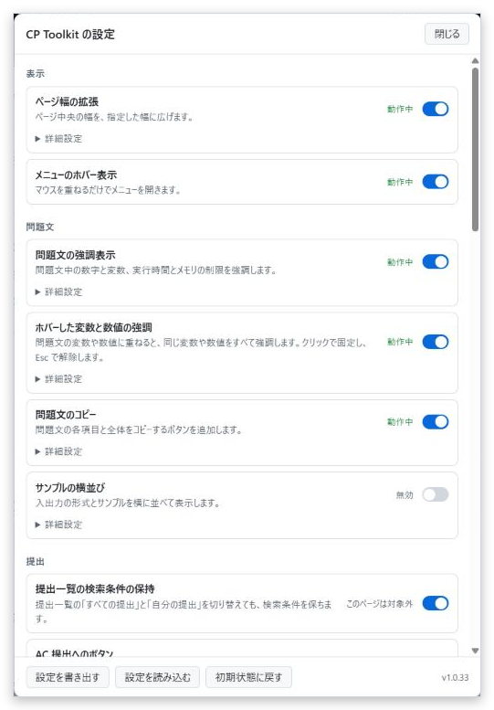

<h1>CP Toolkit</h1>

<strong>27の機能を1本にまとめた競技プログラミング用 UserScript</strong>

AtCoder の入出力例を横に並べる、提出結果を通知する、「問題」タブから各問題へ移動するなど、使いたい機能だけを有効にできます。

<a href="https://greasyfork.org/scripts/603262-cp-toolkit"><strong>インストール</strong></a> ・ <a href="https://github.com/nsubaru11/competitive-programming-tools/blob/main/userscripts/CpToolkit/CHANGELOG.md">変更履歴</a> ・ <a href="https://github.com/nsubaru11/competitive-programming-tools/blob/main/userscripts/CpToolkit/COMPATIBILITY.md">他のスクリプトとの併用</a> ・ <a href="https://github.com/nsubaru11/competitive-programming-tools/issues">不具合と要望</a> ・ <a href="https://github.com/nsubaru11/competitive-programming-tools/blob/main/userscripts/CpToolkit/README.en.md">English</a>

## 1. インストール

1. ブラウザに [Tampermonkey](https://www.tampermonkey.net/) を入れます。
2. Chrome などの Chromium 系のブラウザでは、Tampermonkey の拡張機能の詳細で「ユーザー スクリプトを許可する」をオンにします。
3. [Greasy Fork のページ](https://greasyfork.org/scripts/603262-cp-toolkit)からインストールします。

## 2. 使い方

Tampermonkey の「設定を開く」、または AtCoder のヘッダーにある「CP Toolkit」から設定画面を開きます。各機能の ON/OFF や詳細設定を変更できます。設定はサイトごとに分かれていて、上のタブで切り替えます。タブには、そのサイトで動く機能と項目だけが並びます。Local Runner の URL など一部の項目は、全サイトで共通です。「再読み込みで反映」と表示されたら、下の「ページを再読み込み」を押してください。

 AtCoder の問題ページで開いた設定画面。上のタブで、設定するサイトを切り替えます。

設定画面の一番下の「設定をファイルにバックアップ」で、機能の ON/OFF と詳細設定をファイルに保存できます。「ファイルから設定を復元」で読み込み直せます。設定画面は日本語と英語に対応しています。

 機能の一覧の一番下にある、設定のバックアップ、復元、初期化のボタン。

新しいバージョンがあると通知が届きます。設定画面の「更新する」から更新できます。手動で確認するには「更新を確認」を押します。

## 3. 対象サイト

<table>
<thead>
<tr style="background-color: rgba(128, 128, 128, 0.25)">
<th>サイト&emsp;</th>
<th>使える機能</th>
</tr>
</thead>
<tbody><tr>
<td>AtCoder&emsp;</td>
<td>paiza の言語選択を除く26機能</td>
</tr>
<tr style="background-color: rgba(128, 128, 128, 0.1)">
<td>yukicoder&emsp;</td>
<td>Easy Test+、ショートカットキー、提出補助、コードのヘッダーとフッター</td>
</tr>
<tr>
<td>Codeforces&emsp;</td>
<td>Easy Test+、ショートカットキー、提出補助、コードのヘッダーとフッター</td>
</tr>
<tr style="background-color: rgba(128, 128, 128, 0.1)">
<td>AOJ、Library Checker&emsp;</td>
<td>ショートカットキー、提出補助、コードのヘッダーとフッター</td>
</tr>
<tr>
<td>paiza&emsp;</td>
<td>ショートカットキー、提出補助、paiza の言語選択、コードのヘッダーとフッター</td>
</tr>
</tbody></table>

## 4. 機能一覧

機能名の横に 既定で OFF とあるもの以外は、最初から有効です。機能名を押すと、詳しい説明のページを開きます。

### 4.1 表示

<table>
<thead>
<tr style="background-color: rgba(128, 128, 128, 0.25)">
<th>機能&emsp;</th>
<th>できること</th>
</tr>
</thead>
<tbody><tr>
<td><a href="https://github.com/nsubaru11/competitive-programming-tools/blob/main/userscripts/CpToolkit/docs/features/wide-layout.md"><strong>ページ幅の拡張</strong></a>&emsp;</td>
<td>ページ本文の表示幅を指定できます。</td>
</tr>
<tr style="background-color: rgba(128, 128, 128, 0.1)">
<td><a href="https://github.com/nsubaru11/competitive-programming-tools/blob/main/userscripts/CpToolkit/docs/features/hover-menu.md"><strong>ドロップダウンをホバーで開く</strong></a>&emsp;</td>
<td>ユーザー名や表示言語、「提出結果」にマウスカーソルを重ねると、選択肢が開きます。</td>
</tr>
</tbody></table>

### 4.2 問題文

<table>
<thead>
<tr style="background-color: rgba(128, 128, 128, 0.25)">
<th>機能&emsp;</th>
<th>できること</th>
</tr>
</thead>
<tbody><tr>
<td><a href="https://github.com/nsubaru11/competitive-programming-tools/blob/main/userscripts/CpToolkit/docs/features/efficient-layout.md"><strong>サンプルの横並び</strong></a> 既定で OFF&emsp;</td>
<td>入出力例を横に並べ、幅は内容に合わせて自動で決めます。</td>
</tr>
<tr style="background-color: rgba(128, 128, 128, 0.1)">
<td><a href="https://github.com/nsubaru11/competitive-programming-tools/blob/main/userscripts/CpToolkit/docs/features/statement-highlight.md"><strong>問題文の強調表示</strong></a>&emsp;</td>
<td>問題文の数値や変数、実行時間制限とメモリ制限を強調します。</td>
</tr>
<tr>
<td><a href="https://github.com/nsubaru11/competitive-programming-tools/blob/main/userscripts/CpToolkit/docs/features/variable-hover.md"><strong>ホバーした変数と数値の強調</strong></a>&emsp;</td>
<td>数式の変数や数値にマウスカーソルを重ねると、同じ問題内の同じ変数・数値を強調します。</td>
</tr>
<tr style="background-color: rgba(128, 128, 128, 0.1)">
<td><a href="https://github.com/nsubaru11/competitive-programming-tools/blob/main/userscripts/CpToolkit/docs/features/statement-copy.md"><strong>問題文のコピー</strong></a>&emsp;</td>
<td>問題文や制約などを項目ごとに、またはまとめてコピーできます。</td>
</tr>
</tbody></table>

### 4.3 提出

<table>
<thead>
<tr style="background-color: rgba(128, 128, 128, 0.25)">
<th>機能&emsp;</th>
<th>できること</th>
</tr>
</thead>
<tbody><tr>
<td><a href="https://github.com/nsubaru11/competitive-programming-tools/blob/main/userscripts/CpToolkit/docs/features/result-notifier.md"><strong>提出結果の通知</strong></a>&emsp;</td>
<td>判定が終わると、提出結果を通知します。</td>
</tr>
<tr style="background-color: rgba(128, 128, 128, 0.1)">
<td><a href="https://github.com/nsubaru11/competitive-programming-tools/blob/main/userscripts/CpToolkit/docs/features/language-buttons.md"><strong>言語の切り替えボタン</strong></a>&emsp;</td>
<td>よく使う提出言語を登録し、ボタンひとつで切り替えられます。</td>
</tr>
<tr>
<td><a href="https://github.com/nsubaru11/competitive-programming-tools/blob/main/userscripts/CpToolkit/docs/features/source-comments.md"><strong>コードのヘッダーとフッター</strong></a>&emsp;</td>
<td>コード全体を貼り付けると、登録した文を先頭と末尾に追加します。</td>
</tr>
<tr style="background-color: rgba(128, 128, 128, 0.1)">
<td><a href="https://github.com/nsubaru11/competitive-programming-tools/blob/main/userscripts/CpToolkit/docs/features/submission-shortcuts.md"><strong>AC 提出へのボタン</strong></a>&emsp;</td>
<td>問題ページから、実行時間順やコード長順などで AC 提出の一覧を開けます。</td>
</tr>
<tr>
<td><a href="https://github.com/nsubaru11/competitive-programming-tools/blob/main/userscripts/CpToolkit/docs/features/submission-query.md"><strong>提出一覧の検索条件の保持</strong></a>&emsp;</td>
<td>「すべての提出」と「自分の提出」を切り替えても、検索条件を引き継ぎます。</td>
</tr>
<tr style="background-color: rgba(128, 128, 128, 0.1)">
<td><a href="https://github.com/nsubaru11/competitive-programming-tools/blob/main/userscripts/CpToolkit/docs/features/average-result.md"><strong>テストケースの平均</strong></a>&emsp;</td>
<td>提出の詳細に、テストケースの平均実行時間と平均メモリ使用量を表示します。</td>
</tr>
<tr>
<td><a href="https://github.com/nsubaru11/competitive-programming-tools/blob/main/userscripts/CpToolkit/docs/features/submission-timer.md"><strong>提出の予約</strong></a> 既定で OFF&emsp;</td>
<td>指定した時間後に、エディタにあるコードを提出します。</td>
</tr>
</tbody></table>

### 4.4 コンテスト

<table>
<thead>
<tr style="background-color: rgba(128, 128, 128, 0.25)">
<th>機能&emsp;</th>
<th>できること</th>
</tr>
</thead>
<tbody><tr>
<td><a href="https://github.com/nsubaru11/competitive-programming-tools/blob/main/userscripts/CpToolkit/docs/features/task-dropdown.md"><strong>問題のドロップダウン</strong></a>&emsp;</td>
<td>「問題」タブから各問題へ移動したり、複数の問題をまとめて開いたりできます。</td>
</tr>
<tr style="background-color: rgba(128, 128, 128, 0.1)">
<td><a href="https://github.com/nsubaru11/competitive-programming-tools/blob/main/userscripts/CpToolkit/docs/features/task-status.md"><strong>提出結果による問題の色分け</strong></a>&emsp;</td>
<td>自分の提出結果に応じて、問題一覧と「問題」タブのドロップダウンを色分けします。</td>
</tr>
<tr>
<td><a href="https://github.com/nsubaru11/competitive-programming-tools/blob/main/userscripts/CpToolkit/docs/features/editorial-list.md"><strong>解説の一覧表示</strong></a>&emsp;</td>
<td>解説一覧で、各解説の本文をリンクの下に展開します。</td>
</tr>
<tr style="background-color: rgba(128, 128, 128, 0.1)">
<td><a href="https://github.com/nsubaru11/competitive-programming-tools/blob/main/userscripts/CpToolkit/docs/features/tessoku-difficulty.md"><strong>鉄則本の難易度表示</strong></a>&emsp;</td>
<td>『競技プログラミングの鉄則』の問題一覧に、書籍の難易度を表示します。</td>
</tr>
<tr>
<td><a href="https://github.com/nsubaru11/competitive-programming-tools/blob/main/userscripts/CpToolkit/docs/features/virtual-timer.md"><strong>バーチャル参加のタイマー</strong></a>&emsp;</td>
<td>バーチャル参加の開始までの時間と、競技中の残り時間を表示します。</td>
</tr>
<tr style="background-color: rgba(128, 128, 128, 0.1)">
<td><a href="https://github.com/nsubaru11/competitive-programming-tools/blob/main/userscripts/CpToolkit/docs/features/clar-notifier.md"><strong>Clar の通知</strong></a>&emsp;</td>
<td>コンテスト中に運営からの回答や訂正が届くと通知します。</td>
</tr>
<tr>
<td><a href="https://github.com/nsubaru11/competitive-programming-tools/blob/main/userscripts/CpToolkit/docs/features/contest-calendar.md"><strong>カレンダーへの登録</strong></a>&emsp;</td>
<td>コンテスト名と開催日時を入力した Google カレンダーの予定作成画面を開けます。</td>
</tr>
<tr style="background-color: rgba(128, 128, 128, 0.1)">
<td><a href="https://github.com/nsubaru11/competitive-programming-tools/blob/main/userscripts/CpToolkit/docs/features/top-links.md"><strong>トップページのコンテスト一覧</strong></a>&emsp;</td>
<td>トップページから、ABC・ARC・AGC・AHC の過去のコンテスト一覧を開けます。</td>
</tr>
<tr>
<td><a href="https://github.com/nsubaru11/competitive-programming-tools/blob/main/userscripts/CpToolkit/docs/features/latest-contests.md"><strong>次のコンテスト</strong></a>&emsp;</td>
<td>ヘッダーから今後のコンテストを確認できます。</td>
</tr>
</tbody></table>

### 4.5 成績

<table>
<thead>
<tr style="background-color: rgba(128, 128, 128, 0.25)">
<th>機能&emsp;</th>
<th>できること</th>
</tr>
</thead>
<tbody><tr>
<td><a href="https://github.com/nsubaru11/competitive-programming-tools/blob/main/userscripts/CpToolkit/docs/features/rating-graph.md"><strong>レーティンググラフにパフォーマンスを表示</strong></a>&emsp;</td>
<td>ユーザーページのレーティンググラフに、Rated 参加時のパフォーマンスを重ねて表示します。</td>
</tr>
</tbody></table>

### 4.6 実行・提出の補助

<table>
<thead>
<tr style="background-color: rgba(128, 128, 128, 0.25)">
<th>機能&emsp;</th>
<th>できること</th>
</tr>
</thead>
<tbody><tr>
<td><a href="https://github.com/nsubaru11/competitive-programming-tools/blob/main/userscripts/CpToolkit/docs/features/easy-test.md"><strong>Easy Test+</strong></a> 既定で OFF&emsp;</td>
<td>問題ページでサンプルを実行し、すべて通ったらそのまま提出できます。</td>
</tr>
<tr style="background-color: rgba(128, 128, 128, 0.1)">
<td><a href="https://github.com/nsubaru11/competitive-programming-tools/blob/main/userscripts/CpToolkit/docs/features/submission-helper.md"><strong>提出補助</strong></a> 既定で OFF&emsp;</td>
<td>貼り付けたコードを提出用に変換します。</td>
</tr>
<tr>
<td><a href="https://github.com/nsubaru11/competitive-programming-tools/blob/main/userscripts/CpToolkit/docs/features/keyboard-shortcuts.md"><strong>ショートカットキー</strong></a>&emsp;</td>
<td>提出、入出力例のコピー、問題の切り替え、ページを開く操作などを、好きなキーで行えます。</td>
</tr>
<tr style="background-color: rgba(128, 128, 128, 0.1)">
<td><a href="https://github.com/nsubaru11/competitive-programming-tools/blob/main/userscripts/CpToolkit/docs/features/paiza-language.md"><strong>paiza の言語選択</strong></a>&emsp;</td>
<td>paiza の提出ページで、あらかじめ指定した言語を自動選択します。</td>
</tr>
</tbody></table>

## 5. 他のスクリプトとの併用

同じ機能を持つスクリプトを使う場合は、重なる機能だけ片方を OFF にしてください。両方を有効にすると、ボタンや通知が重複することがあります。

[ac-predictor](https://greasyfork.org/scripts/369954)、[AtCoderStandingsAnalysis](https://greasyfork.org/scripts/398439)、[atcoder-difficulty-display](https://greasyfork.org/scripts/397185) はそのまま併用できます。

一覧は [他のスクリプトとの併用](https://github.com/nsubaru11/competitive-programming-tools/blob/main/userscripts/CpToolkit/COMPATIBILITY.md) を参照してください。

## 6. 外部との通信

このスクリプトは、作者のサーバーへ情報を送りません。AtCoder などの表示中のサイトのほかに、次の場合だけ外部と通信します。

- **Local Runner** は、コードの変換・実行に使う接続先です。Easy Test+ で事前コンパイルが有効な場合は、編集中のコードも送ります。
- **PaizaIO・Wandbox** で実行すると、そのサービスにコードと入力を送ります。内部エラー時にこれらのサービスへ自動で切り替えることはありません。Wandbox のコンパイラ一覧は、実行環境の候補を表示するときに取得し、24時間保存します。
- **jsDelivr** から、解説の数式とコードの表示に使う KaTeX と Prettify、ブラウザでの Python の実行に使う Pyodide、Wandbox の C++ で使う AtCoder Library を、必要なときだけ取得します。
- **更新確認**では、導入元の GitHub または Greasy Fork からバージョン情報を取得します。自動確認は1日1回です。解答コードや設定は送信しません。

KaTeX、Prettify、Pyodide、AtCoder Library は、版を固定して読み込みます。「カレンダーへの登録」はリンクを置くだけで、開いたときにコンテストの情報が Google へ渡ります。

<b>AtCoder への通信の頻度</b>

<ul>
<li><strong>提出結果の通知</strong>: 判定中の提出があるときだけ確認します。間隔はサイトの指定に従い、下限は1秒、最長30分で打ち切ります。通信に失敗すると確認間隔を延ばします。</li>
<li><strong>Clar の通知</strong>: コンテスト中に1分に1回確認します。開始から5分は確認しません。</li>
<li><strong>提出結果による問題の色分け</strong>: 問題一覧を開いたときと、ドロップダウンを初めて開いたときに、自分の提出一覧を全ページ順に取得します。開始から5分は取得しません。</li>
<li><strong>問題のドロップダウン</strong>: コンテストごとに1回取得し、10日間記憶します。</li>
<li><strong>解説の一覧表示</strong>: 画面に表示された解説だけを、0.5秒間隔で取得します。</li>
<li><strong>次のコンテスト</strong>: 「次のコンテスト」を開いたときだけ取得し、1時間記憶します。</li>
<li><strong>レーティンググラフにパフォーマンスを表示</strong>: ユーザーのページを開いたときに1回取得します。</li>
<li><strong>Easy Test+</strong> は、提出ページで入出力例を取得します。AtCoder のコードテストで実行するときはコードと入力を送ります。</li>
</ul>

## 7. 旧スクリプトからの移行

次のスクリプトは CP Toolkit へ統合しました。最終版は [Release](https://github.com/nsubaru11/competitive-programming-tools/releases/tag/legacy-userscripts-final) から入手できます。

AtCoder Custom Default Submissions、AtCoder Easy Test for Java、AtCoder Highlighter、AtCoder Listing Tasks、AtCoder Markdown Copier、AtCoder Performance Overlay、AtCoder Widen Container、Java Code Submitter、Paiza Language Selector

<b>移行の手順</b>

<ol>
<li>旧スクリプトを最終版へ更新し、CP Toolkit も入れる</li>
<li>移行する旧スクリプトが動作するサイトを開き、ページを再読み込みする。paiza の設定を引き継ぐ場合は、paiza でも行う</li>
<li>設定の反映を確認したら、旧スクリプトを削除する</li>
</ol>

移行後は設定をサイト間で共有します。CP Toolkit で設定済みの項目は引き継ぎ時に上書きしません。

引き継ぐ設定は次のとおりです。

<ul>
<li><strong>AtCoder Easy Test for Java</strong>: 編集中のコードの事前コンパイルなどの設定、Local Runner の URL</li>
<li><strong>AtCoder Highlighter</strong>: 強調の色</li>
<li><strong>AtCoder Widen Container</strong>: ページ幅</li>
<li><strong>Paiza Language Selector</strong>: 自動で選ぶ言語</li>
</ul>

<b>旧スクリプトとの違い</b>

<ul>
<li>提出タブの既定の絞り込みは廃止しました。AC 提出は問題ページの「AC 提出」のボタンから開きます。</li>
<li>Easy Test+ は既定で OFF です。AtCoder Easy Test for Java から移行すると ON になります。</li>
<li>デスクトップ通知は、別のタブを見ているときだけでなく、ブラウザから離れているときにも出します。</li>
<li>Java Code Submitter の設定と、旧スクリプトで保存したコードは引き継ぎません。</li>
<li>色の設定は <code>#rrggbb</code> の形式だけを受け付けます。</li>
<li>レーティンググラフの recent は、指定した範囲を表示します。既定は直近20回です。</li>
<li>ショートカットは、修飾キーまで完全に一致したときだけ動きます。</li>
<li>Easy Test+ の下部のパネルの設定ボタンは、CP Toolkit の設定画面を開きます。</li>
<li>Codeforces では、Easy Test+ のボタンは飾りのない表示になります。</li>
</ul>

## 8. ソースコードとライセンス

配布するコードは、TypeScript のソースを1ファイルにまとめたものです。難読化も最小化もしていません。ソースは [GitHub](https://github.com/nsubaru11/competitive-programming-tools/tree/main/userscripts/CpToolkit) で公開しています。

開発には Claude を使用しています。設計と仕様は作者が決めています。

配布物には第三者のコードと turndown を含むので、ライセンスは `MIT AND Apache-2.0 AND 0BSD` です。各機能の出典は [SOURCES.md](https://github.com/nsubaru11/competitive-programming-tools/blob/main/userscripts/CpToolkit/SOURCES.md)、第三者のコードのライセンスは [THIRD_PARTY_NOTICES.md](https://github.com/nsubaru11/competitive-programming-tools/blob/main/THIRD_PARTY_NOTICES.md) にあります。

開発の情報は [DEVELOPMENT.md](https://github.com/nsubaru11/competitive-programming-tools/blob/main/userscripts/CpToolkit/DEVELOPMENT.md) にまとめています。

## 9. 不具合と要望

[GitHub の Issue](https://github.com/nsubaru11/competitive-programming-tools/issues) か、Greasy Fork のフィードバックへお寄せください。
