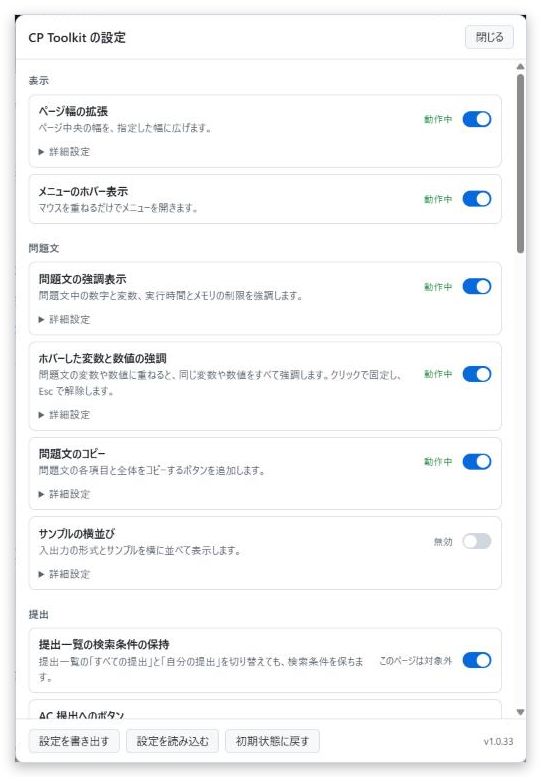

<h1>CP Toolkit</h1>

<strong>競技プログラミングの補助機能を1本にまとめた UserScript</strong>

AtCoder を中心に、問題文、提出、コンテスト、成績のページを使いやすくします。機能ごとに ON/OFF できます。

<a href="https://greasyfork.org/scripts/603262-cp-toolkit"><strong>インストール</strong></a> ・ <a href="https://github.com/nsubaru11/competitive-programming-tools/blob/main/userscripts/CpToolkit/COMPATIBILITY.md">他のスクリプトとの併用</a> ・ <a href="https://github.com/nsubaru11/competitive-programming-tools/issues">不具合と要望</a> ・ <a href="https://github.com/nsubaru11/competitive-programming-tools/blob/main/userscripts/CpToolkit/README.en.md">English</a>

## 1. インストール

1. ブラウザに [Tampermonkey](https://www.tampermonkey.net/) を入れる
2. Chrome などの Chromium 系のブラウザでは、Tampermonkey の拡張機能の詳細で「ユーザー スクリプトを許可する」をオンにする
3. [Greasy Fork のページ](https://greasyfork.org/scripts/603262-cp-toolkit)からインストールする

## 2. 使い方

Tampermonkey のメニューの「設定を開く」、または AtCoder のヘッダーの「CP Toolkit」から設定画面を開きます。各機能はここで ON/OFF できます。機能によっては、「詳細設定」で動作を変えられます。

画面の文言は、サイトの言語に合わせて日本語と英語を切り替えます。

## 3. 対象サイト

<table>
<thead>
<tr style="background-color: rgba(128, 128, 128, 0.25)">
<th>サイト&emsp;</th>
<th>使える機能</th>
</tr>
</thead>
<tbody><tr>
<td>AtCoder&emsp;</td>
<td>paiza の言語選択以外のすべての機能</td>
</tr>
<tr style="background-color: rgba(128, 128, 128, 0.1)">
<td>yukicoder&emsp;</td>
<td>Easy Test+</td>
</tr>
<tr>
<td>Codeforces&emsp;</td>
<td>Easy Test+、Java の提出補助</td>
</tr>
<tr style="background-color: rgba(128, 128, 128, 0.1)">
<td>AOJ、Library Checker&emsp;</td>
<td>Java の提出補助</td>
</tr>
<tr>
<td>paiza&emsp;</td>
<td>Java の提出補助、paiza の言語選択</td>
</tr>
</tbody></table>

## 4. 機能一覧

機能名の横に 既定で OFF とあるもの以外は、最初から有効です。機能名を押すと、詳しい説明のページを開きます。

### 4.1 表示

<table>
<thead>
<tr style="background-color: rgba(128, 128, 128, 0.25)">
<th>機能&emsp;</th>
<th>できること</th>
</tr>
</thead>
<tbody><tr>
<td><a href="https://github.com/nsubaru11/competitive-programming-tools/blob/main/userscripts/CpToolkit/docs/features/wide-layout.md"><strong>ページ幅の拡張</strong></a>&emsp;</td>
<td>ページ中央の幅を、指定した幅に広げます(おすすめは 75%)</td>
</tr>
<tr style="background-color: rgba(128, 128, 128, 0.1)">
<td><a href="https://github.com/nsubaru11/competitive-programming-tools/blob/main/userscripts/CpToolkit/docs/features/hover-menu.md"><strong>メニューのホバー表示</strong></a>&emsp;</td>
<td>マウスを重ねるだけでメニューを開きます</td>
</tr>
</tbody></table>

### 4.2 問題文

<table>
<thead>
<tr style="background-color: rgba(128, 128, 128, 0.25)">
<th>機能&emsp;</th>
<th>できること</th>
</tr>
</thead>
<tbody><tr>
<td><a href="https://github.com/nsubaru11/competitive-programming-tools/blob/main/userscripts/CpToolkit/docs/features/statement-highlight.md"><strong>問題文の強調表示</strong></a>&emsp;</td>
<td>数字、変数、実行時間とメモリの制限を強調します</td>
</tr>
<tr style="background-color: rgba(128, 128, 128, 0.1)">
<td><a href="https://github.com/nsubaru11/competitive-programming-tools/blob/main/userscripts/CpToolkit/docs/features/variable-hover.md"><strong>ホバーした変数と数値の強調</strong></a>&emsp;</td>
<td>変数や数値に重ねると、同じ変数や数値をすべて強調します</td>
</tr>
<tr>
<td><a href="https://github.com/nsubaru11/competitive-programming-tools/blob/main/userscripts/CpToolkit/docs/features/statement-copy.md"><strong>問題文のコピー</strong></a>&emsp;</td>
<td>各項目と全体を Markdown またはプレーンテキストでコピーします</td>
</tr>
<tr style="background-color: rgba(128, 128, 128, 0.1)">
<td><a href="https://github.com/nsubaru11/competitive-programming-tools/blob/main/userscripts/CpToolkit/docs/features/efficient-layout.md"><strong>サンプルの横並び</strong></a> 既定で OFF&emsp;</td>
<td>入出力の形式とサンプルを横に並べます</td>
</tr>
</tbody></table>

### 4.3 提出

<table>
<thead>
<tr style="background-color: rgba(128, 128, 128, 0.25)">
<th>機能&emsp;</th>
<th>できること</th>
</tr>
</thead>
<tbody><tr>
<td><a href="https://github.com/nsubaru11/competitive-programming-tools/blob/main/userscripts/CpToolkit/docs/features/submission-query.md"><strong>提出一覧の検索条件の保持</strong></a>&emsp;</td>
<td>「すべての提出」と「自分の提出」を切り替えても、検索条件を保ちます。URL の言語名の大文字と小文字の違いも補います</td>
</tr>
<tr style="background-color: rgba(128, 128, 128, 0.1)">
<td><a href="https://github.com/nsubaru11/competitive-programming-tools/blob/main/userscripts/CpToolkit/docs/features/submission-shortcuts.md"><strong>AC 提出へのボタン</strong></a>&emsp;</td>
<td>この問題の AC 提出を、実行時間、コード長、提出時間、メモリの順で開きます</td>
</tr>
<tr>
<td><a href="https://github.com/nsubaru11/competitive-programming-tools/blob/main/userscripts/CpToolkit/docs/features/language-buttons.md"><strong>言語の切り替えボタン</strong></a>&emsp;</td>
<td>よく使う言語をボタンとして並べて保存し、1回の操作で切り替えます</td>
</tr>
<tr style="background-color: rgba(128, 128, 128, 0.1)">
<td><a href="https://github.com/nsubaru11/competitive-programming-tools/blob/main/userscripts/CpToolkit/docs/features/source-comments.md"><strong>ヘッダーとフッター</strong></a>&emsp;</td>
<td>貼り付けたコードの先頭と末尾に、参照元の URL などのコメントを追記します</td>
</tr>
<tr>
<td><a href="https://github.com/nsubaru11/competitive-programming-tools/blob/main/userscripts/CpToolkit/docs/features/result-notifier.md"><strong>提出結果の通知</strong></a>&emsp;</td>
<td>判定が終わると、どのページにいてもすぐに通知します</td>
</tr>
<tr style="background-color: rgba(128, 128, 128, 0.1)">
<td><a href="https://github.com/nsubaru11/competitive-programming-tools/blob/main/userscripts/CpToolkit/docs/features/average-result.md"><strong>テストケースの平均</strong></a>&emsp;</td>
<td>提出の詳細に、実行時間とメモリの平均を表示します</td>
</tr>
<tr>
<td><a href="https://github.com/nsubaru11/competitive-programming-tools/blob/main/userscripts/CpToolkit/docs/features/submission-timer.md"><strong>提出の予約</strong></a> 既定で OFF&emsp;</td>
<td>指定した時間が経ったら提出します</td>
</tr>
</tbody></table>

### 4.4 コンテスト

<table>
<thead>
<tr style="background-color: rgba(128, 128, 128, 0.25)">
<th>機能&emsp;</th>
<th>できること</th>
</tr>
</thead>
<tbody><tr>
<td><a href="https://github.com/nsubaru11/competitive-programming-tools/blob/main/userscripts/CpToolkit/docs/features/clar-notifier.md"><strong>Clar の通知</strong></a>&emsp;</td>
<td>コンテスト中に運営からの回答や訂正が届くと通知します</td>
</tr>
<tr style="background-color: rgba(128, 128, 128, 0.1)">
<td><a href="https://github.com/nsubaru11/competitive-programming-tools/blob/main/userscripts/CpToolkit/docs/features/task-dropdown.md"><strong>問題のドロップダウン</strong></a>&emsp;</td>
<td>「問題」タブから各問題へ移動でき、複数の問題をまとめて開けます</td>
</tr>
<tr>
<td><a href="https://github.com/nsubaru11/competitive-programming-tools/blob/main/userscripts/CpToolkit/docs/features/task-status.md"><strong>問題の正誤の色分け</strong></a>&emsp;</td>
<td>問題一覧とドロップダウンを、コンテスト後を含む自分の提出で色分けします</td>
</tr>
<tr style="background-color: rgba(128, 128, 128, 0.1)">
<td><a href="https://github.com/nsubaru11/competitive-programming-tools/blob/main/userscripts/CpToolkit/docs/features/editorial-list.md"><strong>解説の一覧表示</strong></a>&emsp;</td>
<td>すべての問題の解説をまとめて表示します</td>
</tr>
<tr>
<td><a href="https://github.com/nsubaru11/competitive-programming-tools/blob/main/userscripts/CpToolkit/docs/features/top-links.md"><strong>トップページのコンテスト一覧</strong></a>&emsp;</td>
<td>種類ごとの過去問へのリンクに置き換えます</td>
</tr>
<tr style="background-color: rgba(128, 128, 128, 0.1)">
<td><a href="https://github.com/nsubaru11/competitive-programming-tools/blob/main/userscripts/CpToolkit/docs/features/latest-contests.md"><strong>次のコンテスト</strong></a>&emsp;</td>
<td>ホームの「次のコンテスト」の一覧を、ヘッダーのメニューから開けます</td>
</tr>
<tr>
<td><a href="https://github.com/nsubaru11/competitive-programming-tools/blob/main/userscripts/CpToolkit/docs/features/contest-calendar.md"><strong>カレンダーへの登録</strong></a>&emsp;</td>
<td>コンテストのページに、Google カレンダーへのリンクを置きます</td>
</tr>
<tr style="background-color: rgba(128, 128, 128, 0.1)">
<td><a href="https://github.com/nsubaru11/competitive-programming-tools/blob/main/userscripts/CpToolkit/docs/features/virtual-timer.md"><strong>バーチャル参加のタイマー</strong></a>&emsp;</td>
<td>開始までの時間と残り時間を、右下の時計に表示します</td>
</tr>
<tr>
<td><a href="https://github.com/nsubaru11/competitive-programming-tools/blob/main/userscripts/CpToolkit/docs/features/tessoku-difficulty.md"><strong>鉄則本の難易度表示</strong></a>&emsp;</td>
<td>「競技プログラミングの鉄則」の問題一覧に、書籍の難易度を表示します</td>
</tr>
</tbody></table>

### 4.5 成績

<table>
<thead>
<tr style="background-color: rgba(128, 128, 128, 0.25)">
<th>機能&emsp;</th>
<th>できること</th>
</tr>
</thead>
<tbody><tr>
<td><a href="https://github.com/nsubaru11/competitive-programming-tools/blob/main/userscripts/CpToolkit/docs/features/rating-graph.md"><strong>ユーザーページのグラフへのパフォーマンス表示</strong></a>&emsp;</td>
<td>ユーザーページのレーティンググラフにパフォーマンスを重ね、最近の範囲を回数か割合で指定できます</td>
</tr>
</tbody></table>

### 4.6 実行環境

<table>
<thead>
<tr style="background-color: rgba(128, 128, 128, 0.25)">
<th>機能&emsp;</th>
<th>できること</th>
</tr>
</thead>
<tbody><tr>
<td><a href="https://github.com/nsubaru11/competitive-programming-tools/blob/main/userscripts/CpToolkit/docs/features/java-submit.md"><strong>Java の提出補助</strong></a>&emsp;</td>
<td>貼り付けたコードを提出用に変換し、ショートカットで提出できます</td>
</tr>
<tr style="background-color: rgba(128, 128, 128, 0.1)">
<td><a href="https://github.com/nsubaru11/competitive-programming-tools/blob/main/userscripts/CpToolkit/docs/features/local-runner.md"><strong>Local Runner</strong></a>&emsp;</td>
<td>コードの変換と実行に使う、手元のサーバーへ接続します。同じ API を持つ自作のサーバーも使えます</td>
</tr>
<tr>
<td><a href="https://github.com/nsubaru11/competitive-programming-tools/blob/main/userscripts/CpToolkit/docs/features/easy-test.md"><strong>Easy Test+</strong></a> 既定で OFF&emsp;</td>
<td>問題ページからサンプルを実行し、結果を確かめます</td>
</tr>
<tr style="background-color: rgba(128, 128, 128, 0.1)">
<td><a href="https://github.com/nsubaru11/competitive-programming-tools/blob/main/userscripts/CpToolkit/docs/features/paiza-language.md"><strong>paiza の言語選択</strong></a>&emsp;</td>
<td>paiza の提出ページで、指定した言語を自動で選びます。言語を設定するまでは動きません</td>
</tr>
</tbody></table>

## 5. 他のスクリプトとの併用

CP Toolkit と同じ機能を持つスクリプトとの併用は推奨しません。ボタンや通知が二重になることがあるので、機能ごとにどちらか片方だけを使ってください。そのスクリプトを使い続ける場合は、CP Toolkit の設定で同じ機能をオフにしてください。

機能が重ならないスクリプトは、そのまま併用できます。たとえば ac-predictor、AtCoderStandingsAnalysis、atcoder-difficulty-display です。

一覧は [他のスクリプトとの併用](https://github.com/nsubaru11/competitive-programming-tools/blob/main/userscripts/CpToolkit/COMPATIBILITY.md) を参照してください。

## 6. 外部との通信

このスクリプトは、作者のサーバーへ情報を送りません。AtCoder などの表示中のサイトのほかに、次の場合だけ外部と通信します。

- **手元の Local Runner**(既定は `http://localhost:8080`): コードの変換と実行のために、コードを手元の PC へ送ります
- **PaizaIO、Wandbox**: Easy Test+ でこれらを実行環境に選んだときだけ、コードと入力を送ります。ほかの実行環境から自動で切り替わることはありません
- **jsDelivr**: 解説の数式とコードの表示に使う KaTeX と Prettify、ブラウザでの Python の実行に使う Pyodide、Wandbox の C++ で使う AtCoder Library を、必要なときだけ取得します

KaTeX、Prettify、Pyodide、AtCoder Library は、版を固定して読み込みます。「カレンダーへの登録」はリンクを置くだけで、開いたときにコンテストの情報が Google へ渡ります。

<b>AtCoder への通信の頻度</b>

<ul>
<li><strong>提出結果の通知</strong>: 判定中の提出があるときだけ確認します。間隔はサイトの指定に従い、下限は1秒、最長30分で打ち切ります</li>
<li><strong>Clar の通知</strong>: コンテスト中に1分に1回確認します。開始から5分は確認しません</li>
<li><strong>問題の正誤の色分け</strong>: 問題一覧を開いたときと、ドロップダウンを初めて開いたときに、自分の提出一覧を全ページ順に取得します。開始から5分は取得しません</li>
<li><strong>問題のドロップダウン</strong>: コンテストごとに1回取得し、10日間記憶します</li>
<li><strong>解説の一覧表示</strong>: 画面に表示された解説だけを、0.5秒間隔で取得します</li>
<li><strong>次のコンテスト</strong>: メニューを開いたときだけ取得し、1時間記憶します</li>
<li><strong>ユーザーページのグラフへのパフォーマンス表示</strong>: ユーザーのページを開いたときに1回取得します</li>
<li><strong>Easy Test+</strong>: 実行したときだけ通信します。AtCoder のコードテストは、タブをまたいでも1件ずつ順番に実行します</li>
</ul>

通信に失敗したときは、確認の間隔を広げます。

## 7. 旧スクリプトからの移行

次のスクリプトは CP Toolkit へ統合しました。最終版は [Release](https://github.com/nsubaru11/competitive-programming-tools/releases/tag/legacy-userscripts-final) から入手できます。

AtCoder Custom Default Submissions、AtCoder Easy Test for Java、AtCoder Highlighter、AtCoder Listing Tasks、AtCoder Markdown Copier、AtCoder Performance Overlay、AtCoder Widen Container、Java Code Submitter、Paiza Language Selector

<b>移行の手順</b>

<ol>
<li>旧スクリプトを最終版へ更新し、CP Toolkit も入れる</li>
<li>旧スクリプトが動くサイトを1つ開き、もう一度読み込む。設定は自動で引き継がれ、すでに CP Toolkit で設定した項目は上書きしません</li>
<li>設定の反映を確認したら、旧スクリプトを削除する</li>
</ol>

両方が入っている間は、旧スクリプトは本体を実行しません。設定はサイトをまたいで共有するので、サイトごとに繰り返す必要はありません。

引き継ぐ設定は次のとおりです。

<ul>
<li><strong>AtCoder Easy Test for Java</strong>: 編集中のコードの事前コンパイルなどの設定、Local Runner の URL</li>
<li><strong>AtCoder Highlighter</strong>: 強調の色</li>
<li><strong>AtCoder Widen Container</strong>: ページ幅</li>
<li><strong>Paiza Language Selector</strong>: 自動で選ぶ言語</li>
</ul>

<b>旧スクリプトとの違い</b>

<ul>
<li>提出タブの既定の絞り込みは廃止しました。AC 提出は問題ページの「AC提出」のボタンから開きます</li>
<li>Easy Test+ は既定で OFF です。旧版から移行すると ON になります</li>
<li>デスクトップ通知は、別のタブを見ているときだけでなく、ブラウザから離れているときにも出します</li>
<li>Java Code Submitter の設定と、Easy Test+ に保存したコードは引き継ぎません</li>
<li>色の設定は <code>#rrggbb</code> の形式だけを受け付けます</li>
<li>レーティンググラフの recent は、指定した範囲を表示します。既定は直近20回です</li>
<li>ショートカットは、修飾キーまで完全に一致したときだけ動きます</li>
<li>Easy Test+ の下部のパネルの設定ボタンは、CP Toolkit の設定画面を開きます</li>
<li>Codeforces では、Easy Test+ のボタンは飾りのない表示になります</li>
</ul>

## 8. ソースコードとライセンス

配布するコードは、TypeScript のソースを1ファイルにまとめたものです。難読化も最小化もしていません。ソースは [GitHub](https://github.com/nsubaru11/competitive-programming-tools/tree/main/userscripts/CpToolkit) で公開しています。

開発には Claude Opus 5.5 を使用しました。設計と仕様は作者が決めています。

配布物には第三者のコードと turndown を含むので、ライセンスは `MIT AND Apache-2.0 AND 0BSD` です。各機能の出典は [SOURCES.md](https://github.com/nsubaru11/competitive-programming-tools/blob/main/userscripts/CpToolkit/SOURCES.md)、第三者のコードのライセンスは [THIRD_PARTY_NOTICES.md](https://github.com/nsubaru11/competitive-programming-tools/blob/main/THIRD_PARTY_NOTICES.md) にあります。

開発の情報は [DEVELOPMENT.md](https://github.com/nsubaru11/competitive-programming-tools/blob/main/userscripts/CpToolkit/DEVELOPMENT.md) にまとめています。

## 9. 不具合と要望

[GitHub の Issue](https://github.com/nsubaru11/competitive-programming-tools/issues) か、Greasy Fork のフィードバックへお寄せください。
