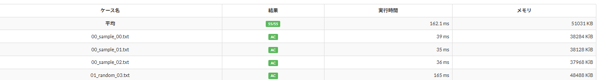

# Test case averages

[Back to the feature list](../../README.en.md#4-feature-list) ・ [日本語](average-result.md)

> Shows average time and memory on the submission page.

## How it works

- Adds an "Average" row at the top of the test case table, showing the number of ACs and the average time and memory
- When a TLE case is included, the average time has a "+", because it is computed with the cut-off time and is shorter than the real one

## Pages

- Submission details
