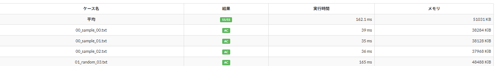

# テストケースの平均

[機能一覧へ戻る](../../README.md#4-機能一覧) ・ [English](average-result.en.md)

> 提出の詳細に、実行時間とメモリの平均を表示します。

## 使い方

- 提出の詳細のテストケースの表の先頭に「平均」の行を足し、AC の数、実行時間の平均、メモリの平均を表示します
- TLE のケースを含むときは、実行時間の平均に「+」を付けます。打ち切られた時間で計算するので、実際より短いためです

## 動くページ

- 提出の詳細
