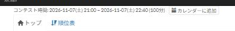

# Add to calendar

[Back to the feature list](../../README.en.md#4-feature-list) ・ [日本語](contest-calendar.md)

> Adds a link to contest pages that registers the contest in Google Calendar.

## How it works

- Adds an "Add to calendar" link next to the contest time on pages of upcoming and running contests
- The link opens the Google Calendar event form with the contest name and time. The contest details reach Google only when you open it

## Pages

- Contest pages
