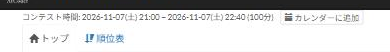

# カレンダーへの登録

[機能一覧へ戻る](../../README.md#4-機能一覧) ・ [English](contest-calendar.en.md)

> コンテストのページに、Google カレンダーへ登録するリンクを追加します。

## 使い方

- 開催前と開催中のコンテストのページで、コンテスト時間の横に「カレンダーに追加」のリンクを置きます
- リンクを開くと、コンテストの名前と時間を入れた Google カレンダーの登録画面が開きます。リンクを開いたときに、コンテストの情報が Google へ渡ります

## 動くページ

- コンテストのページ
