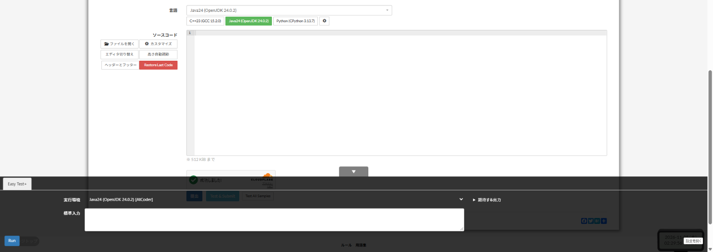

# Easy Test+

[Back to the feature list](../../README.en.md#4-feature-list) ・ [日本語](easy-test.md)

> Based on AtCoder Easy Test v2, with additional features. Runs samples from the task page and checks the results. With Local Runner, code runs on your PC and the code you are editing is compiled in advance. Enable only one of this and AtCoder Easy Test v2, because using both duplicates the buttons.

**This feature is off by default. Turn it on in the settings.**

## How it works

- Based on [AtCoder Easy Test v2](https://greasyfork.org/scripts/433152), with additional features. **Bold items are not in v2**
- From the task page, you can run samples (Run, Test All Samples) and test before submitting (Test & Submit). **A submission can be canceled midway**
- **When no samples are found, nothing is tested or submitted**
- The execution environment can be AtCoder custom test, Python in the browser, PaizaIO or Wandbox. C++ on Wandbox can use AtCoder Library. Code is sent to PaizaIO or Wandbox only when you choose them
- When an environment returns an internal error, the code runs again in another candidate. **It never switches to external services (PaizaIO, Wandbox) automatically**
- **AtCoder custom tests run one at a time, even across tabs**
- Output can be compared with an allowable error. The code you ran is saved per task and can be restored with "Restore Last Code"
- <kbd>Ctrl</kbd>+<kbd>Enter</kbd> runs Test & Submit, <kbd>Alt</kbd>+<kbd>Enter</kbd> runs Test All Samples, and <kbd>Alt</kbd>+<kbd>Esc</kbd> opens or closes the bottom panel
- With [Local Runner](local-runner.en.md) or a server of your own with the same API, the languages that server supports run on your PC. **The code you are editing is compiled in advance, so results come back sooner.** The dedicated Local Runner supports Java, C++, C and Python. Memory is the cumulative allocation for Java and the peak usage for the other languages
- Enable only one of this and AtCoder Easy Test v2, because using both duplicates the buttons

## Detailed settings

Change these under "Detailed settings" of each feature in the settings.

| Setting                                        | Default |
|------------------------------------------------|---------|
| Precompile edited code with Local Runner       | On      |
| Use shortcuts (Ctrl+Enter, Alt+Enter, Alt+Esc) | On      |
| Number of saved solutions                      | `10`    |
| Allowed error                                  | `1e-6`  |

## Pages

- Task pages
- Submit page
- yukicoder problem pages
- Codeforces problem pages
