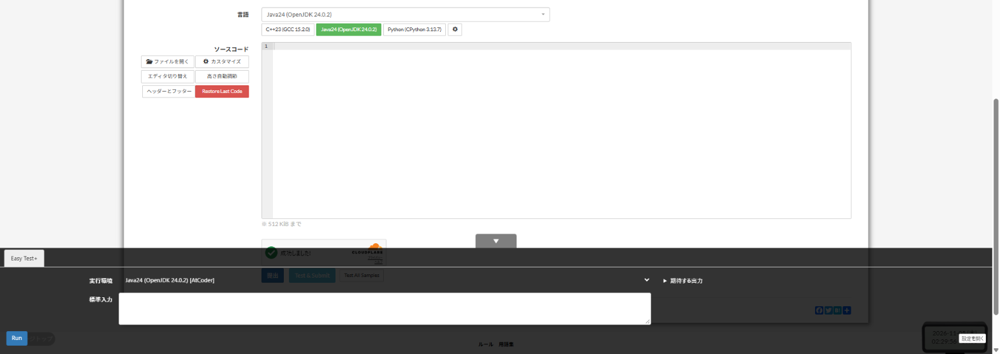

# Easy Test+

[機能一覧へ戻る](../../README.md#4-機能一覧) ・ [English](easy-test.en.md)

> AtCoder Easy Test v2 をもとに、機能を加えたものです。問題ページからサンプルを実行して結果を確認します。Local Runner に接続すると手元の PC で実行でき、編集中のコードを事前にコンパイルします。AtCoder Easy Test v2 と同時に有効にするとボタンが重なるので、どちらか片方にしてください。

**この機能は既定で OFF です。設定画面で有効にしてください。**

## 使い方

- [AtCoder Easy Test v2](https://greasyfork.org/scripts/433152) をもとに、機能を加えたものです。**太字は v2 にない機能です**
- 問題ページから、サンプルの実行(Run、Test All Samples)と、テストしてからの提出(Test & Submit)ができます。**提出は途中で中止できます**
- **サンプルが見つからないときは、テストも提出もしません**
- 実行環境は、AtCoder のコードテスト、ブラウザでの Python の実行、PaizaIO、Wandbox から選べます。Wandbox の C++ では AtCoder Library を使えます。PaizaIO と Wandbox へコードを送るのは、それらを選んだときだけです
- 実行環境が内部エラーを返したときは、ほかの候補で実行し直します。**外部のサービス(PaizaIO、Wandbox)へは自動で切り替えません**
- **AtCoder のコードテストは、タブをまたいでも1件ずつ順番に実行します**
- 出力は許容誤差を指定して比べられます。実行したコードは問題ごとに保存し、「Restore Last Code」で戻せます
- <kbd>Ctrl</kbd>+<kbd>Enter</kbd> で Test & Submit、<kbd>Alt</kbd>+<kbd>Enter</kbd> で Test All Samples、<kbd>Alt</kbd>+<kbd>Esc</kbd> で下のパネルの開閉です
- [Local Runner](local-runner.md) か、同じ API を持つ自作のサーバーに接続すると、そのサーバーが対応する言語を手元の PC で実行できます。**編集中のコードを事前にコンパイルするので、結果が早く出ます**。メモリはサーバーが返した値を累積の割り当て量として表示します。専用の Local Runner が対応しているのは Java です
- AtCoder Easy Test v2 と同時に有効にするとボタンが重なるので、どちらか片方にしてください

## 詳細設定

設定画面の各機能の「詳細設定」で変えられます。

| 項目                                                 | 既定値 |
|------------------------------------------------------|--------|
| Local Runner で編集中のコードを事前にコンパイルする  | ON     |
| ショートカットを使う(Ctrl+Enter、Alt+Enter、Alt+Esc) | ON     |
| 保存するコードの数                                   | `10`   |
| 許容誤差                                             | `1e-6` |

## 動くページ

- 問題ページ
- 提出ページ
- yukicoder の問題ページ
- Codeforces の問題ページ
