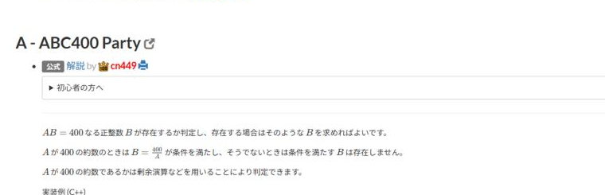

# All editorials

[Back to the feature list](../../README.en.md#4-feature-list) ・ [日本語](editorial-list.md)

> Shows the editorials of every task on the editorial page.

## How it works

- On the editorial page of a contest, the text of each editorial is expanded below its link so all of them can be read on one page
- Only the editorials shown on screen are fetched, every 0.5 seconds

## Pages

- Editorial page
