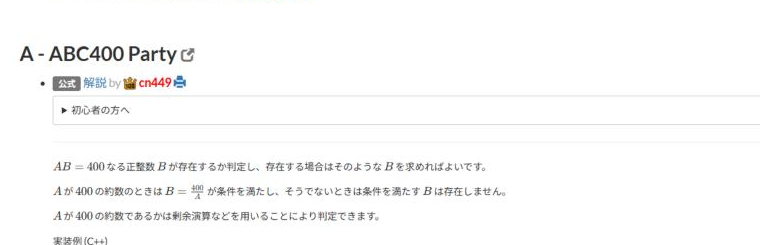

# 解説の一覧表示

[機能一覧へ戻る](../../README.md#4-機能一覧) ・ [English](editorial-list.en.md)

> 解説ページで、すべての問題の解説をまとめて表示します。

## 使い方

- コンテストの解説ページで、各問題の解説の本文をリンクの下に展開し、1ページで読めるようにします
- 画面に表示された解説だけを、0.5秒間隔で取得します

## 動くページ

- 解説ページ
