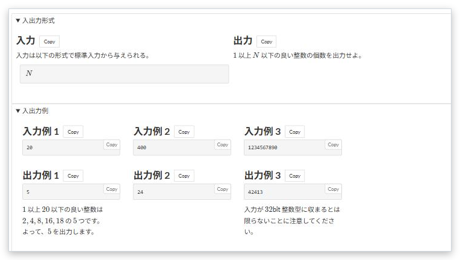

# Side-by-side samples

[Back to the feature list](../../README.en.md#4-feature-list) ・ [日本語](efficient-layout.md)

> Places the input and output formats and samples side by side.

**This feature is off by default. Turn it on in the settings.**

## How it works

- Places the input and output formats side by side, and each sample pair next to the others. Scroll sideways when they do not fit
- The width of each sample pair can be set as a percentage of the screen. **20 to 30 is recommended by the author**

## Detailed settings

Change these under "Detailed settings" of each feature in the settings.

| Setting | Default |
|---|---|
| Width of each sample pair (% of the screen; 20 to 30 recommended) | `23` |

## Pages

- Task pages
- Printable task list
