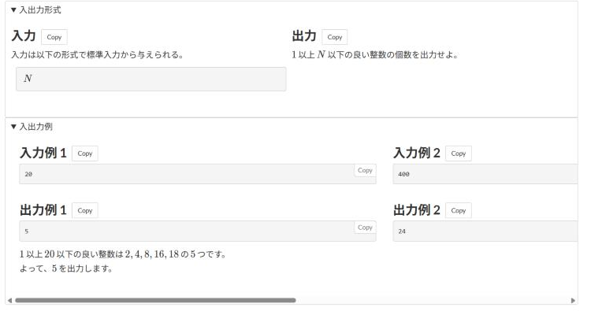

# サンプルの横並び

[機能一覧へ戻る](../../README.md#4-機能一覧) ・ [English](efficient-layout.en.md)

> 入出力の形式とサンプルを横に並べて表示します。

**この機能は既定で OFF です。設定画面で有効にしてください。**

## 使い方

- 入力と出力の形式を左右に並べ、入出力例を1組ずつ横に並べます。並びきらないときは横にスクロールします
- 入出力例1組の幅は、画面幅に対する割合で指定できます

## 詳細設定

設定画面の各機能の「詳細設定」で変えられます。

| 項目 | 既定値 |
|---|---|
| サンプル1組の幅(画面幅に対する %) | `60` |

## 動くページ

- 問題ページ
- 問題の一括表示(印刷用)のページ
