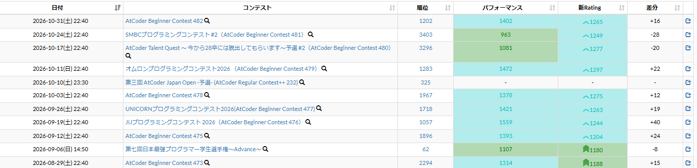

# Colored contest history

[Back to the feature list](../../README.en.md#4-feature-list) ・ [日本語](history-colors.md)

> Colors performance and rating values in the contest history.

## How it works

- Colors the performance and rating values in the contest history by rating color
- The coloring can be None, Text or Background for each column in the detailed settings

## Detailed settings

Change these under "Detailed settings" of each feature in the settings.

| Setting | Default |
|---|---|
| Performance coloring | Background |
| Rating coloring | Background |

## Pages

- Contest history
