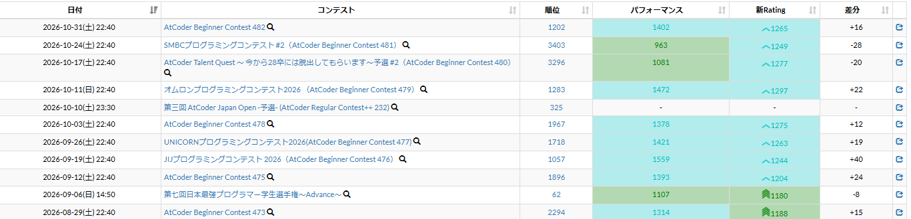

# 成績表の色付け

[機能一覧へ戻る](../../README.md#4-機能一覧) ・ [English](history-colors.en.md)

> 成績表のパフォーマンスとレーティングに色を付けます。

## 使い方

- コンテスト成績表のパフォーマンスとレーティングに、レーティングの色を付けます
- 色の付け方は、詳細設定で項目ごとに「なし」「文字」「背景」から選べます

## 詳細設定

設定画面の各機能の「詳細設定」で変えられます。

| 項目 | 既定値 |
|---|---|
| パフォーマンスの色付け | 背景 |
| レーティングの色付け | 背景 |

## 動くページ

- コンテスト成績表
