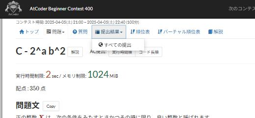

# Open menus on hover

[Back to the feature list](../../README.en.md#4-feature-list) ・ [日本語](hover-menu.md)

> Opens menus when the pointer moves over them.

## How it works

- Menus in the header and the contest tabs open when the pointer moves over them, without clicking
- Collapsed sections in statements can start expanded

## Detailed settings

Change these under "Detailed settings" of each feature in the settings.

| Setting | Default |
|---|---|
| Expand collapsed sections in statements | On |

## Pages

- Every AtCoder page
