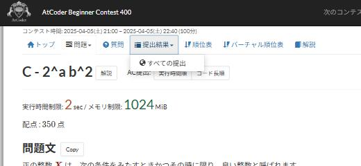

# メニューのホバー表示

[機能一覧へ戻る](../../README.md#4-機能一覧) ・ [English](hover-menu.en.md)

> マウスを重ねるだけでメニューを開きます。

## 使い方

- ヘッダーやコンテストのタブのメニューを、クリックせずにマウスを重ねるだけで開きます
- 問題文の折りたたまれた項目を、最初から開いた状態にできます

## 詳細設定

設定画面の各機能の「詳細設定」で変えられます。

| 項目 | 既定値 |
|---|---|
| 問題文の折りたたみを最初から開く | ON |

## 動くページ

- AtCoder のすべてのページ
