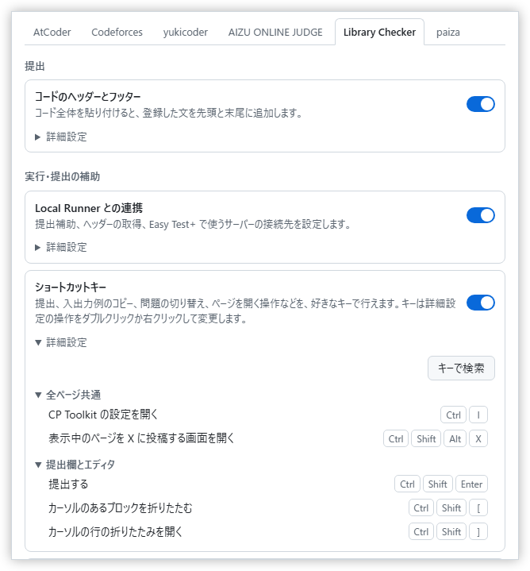

# Keyboard shortcuts

[Back to the feature list](../../README.en.md#4-feature-list) ・ [日本語](keyboard-shortcuts.md)

> Submit, copy samples, switch tasks, open pages and more with keys you choose.

## How it works

- In the detailed settings, double-click or right-click an action to open the key input (with the keyboard, select the action and press <kbd>Enter</kbd>). Press the keys to assign and choose “OK”. Each action takes one combination.
- “Remove” leaves the key empty, so the action has no key. <kbd>Esc</kbd> cannot be assigned; it closes the input without changes.
- You can assign letters, digits, symbols, F1 to F12, <kbd>Enter</kbd>, <kbd>Space</kbd>, <kbd>Tab</kbd>, <kbd>Backspace</kbd>, <kbd>Delete</kbd> and arrows, combined with modifier keys. Keys the browser takes first, such as <kbd>Ctrl</kbd>+<kbd>W</kbd>, cannot be assigned.
- On a Mac, `Ctrl` is the control key, `Alt` is the option key and `Cmd` is the command key. The default keys combine control and option, so they work on a Mac as they are.
- Every key works whether or not you are in the submission field or the editor. Most actions use three modifier keys so that they do not overlap with the keys of the sites and Easy Test+.
- Letters and digits are shown as printed on the key, not as the character Shift or other modifiers produce (`Shift+1`, not `!`). The same goes for `[` and `]` (e.g. `Ctrl+Shift+[`).
- For actions that have a button, hover over the button to see the assigned key.

### Submitting and testing

- If you press the submit key while the [submission helper](submission-helper.en.md) is transforming pasted code, the code is submitted after the transform finishes.
- Folding folds the innermost block around the cursor (such as `{}` or a comment) that is not folded yet. The unfold key opens the fold on the cursor line. Any language works. This does not work in the yukicoder editor.
- The test keys work on pages where [Easy Test+](easy-test.en.md) is enabled.

 Hover over the submit button to see the assigned key.

### Copying samples and the statement

- Sample inputs and outputs are copied with separate keys. Press the modifiers followed by the sample number (1 to 9). By default, <kbd>Ctrl</kbd>+<kbd>Alt</kbd>+<kbd>1</kbd> copies sample input 1 and <kbd>Ctrl</kbd>+<kbd>Shift</kbd>+<kbd>Alt</kbd>+<kbd>1</kbd> copies sample output 1.
- On the AtCoder submit page, the samples of the selected task are copied.
- Copying the statement copies the same text as “Copy All” of [Copy statement](statement-copy.en.md).

### Switching tasks and opening pages

- The previous and next task keys work on task pages. For the task key, press the modifiers followed by A to Z. The task letters are ignored: A, B, C… count from the top of the task list. Tasks after the 26th cannot be opened.
- Tasks open in the same tab. The task list, my submissions, the standings, the editorial, the custom test and AC submissions open in a new tab so that the current page stays open.
- On a task page, the editorial key opens the editorial of that task. Codeforces has no editorial page, so this key does nothing there.
- AC submissions open the same lists as the [AC submission buttons](submission-shortcuts.en.md). They work even for orders whose button is hidden.
- The post to X opens with the title and URL of the current page. You post it yourself from the opened page.

## Detailed settings

Open this feature’s “Detailed settings” in CP Toolkit. Keys are set per site, and only the actions that work on that site are shown, grouped by the pages they work on.

Choose “Find by shortcut” at the top right of the list and press keys to show only the actions that use them. Actions that combine modifiers with a number or letter are found by the modifiers alone or by the whole combination. “Remove” clears the search.

 The detailed settings on the Library Checker tab. Only the five keys that work on that site are listed.

### Global

| Setting                               | Default          | Sites |
|---------------------------------------|------------------|-------|
| Open the CP Toolkit settings          | Ctrl+I           | All   |
| Open a post to X for the current page | Ctrl+Shift+Alt+X | All   |

### Submission & Editor

| Setting                            | Default          | Sites             |
|------------------------------------|------------------|-------------------|
| Submit                             | Ctrl+Shift+Enter | All               |
| Fold the block at the cursor       | Ctrl+Shift+[     | All but yukicoder |
| Unfold the fold on the cursor line | Ctrl+Shift+]     | All but yukicoder |

### Problem Page

Easy Test+ and sample copying also work on the AtCoder submit page.

| Setting                                                         | Default              | Sites                          |
|-----------------------------------------------------------------|----------------------|--------------------------------|
| Test with Easy Test+, then submit                               | Ctrl+Enter           | AtCoder, Codeforces, yukicoder |
| Test all samples with Easy Test+                                | Alt+Enter            | AtCoder, Codeforces, yukicoder |
| Open or close the Easy Test+ panel                              | Ctrl+Shift+Alt+D     | AtCoder, Codeforces, yukicoder |
| Copy a sample input (these modifiers and a number from 1 to 9)  | Ctrl+Alt             | AtCoder, Codeforces, yukicoder |
| Copy a sample output (these modifiers and a number from 1 to 9) | Ctrl+Shift+Alt       | AtCoder, Codeforces, yukicoder |
| Copy the whole statement                                        | Ctrl+Shift+Alt+P     | AtCoder                        |
| Open the previous task                                          | Ctrl+Shift+Alt+Left  | AtCoder, Codeforces            |
| Open the next task                                              | Ctrl+Shift+Alt+Right | AtCoder, Codeforces            |
| Open AC submissions by execution time                           | Ctrl+Shift+Alt+F     | AtCoder                        |
| Open AC submissions by code length                              | Ctrl+Shift+Alt+L     | AtCoder                        |
| Open AC submissions by submission time                          | Ctrl+Shift+Alt+N     | AtCoder                        |
| Open AC submissions by memory                                   | Ctrl+Shift+Alt+M     | AtCoder                        |

### Contest Pages

| Setting                                                                          | Default          | Sites               |
|----------------------------------------------------------------------------------|------------------|---------------------|
| Open a task (these modifiers and A to Z: A, B, C… from the top of the task list) | Ctrl+Alt         | AtCoder, Codeforces |
| Open the task list                                                               | Ctrl+Shift+Alt+T | AtCoder, Codeforces |
| Open my submissions                                                              | Ctrl+Shift+Alt+S | AtCoder, Codeforces |
| Open the standings                                                               | Ctrl+Shift+Alt+R | AtCoder, Codeforces |
| Open the editorial                                                               | Ctrl+Shift+Alt+E | AtCoder             |
| Open the custom test                                                             | Ctrl+Shift+Alt+C | AtCoder, Codeforces |

If several actions share a key, they are tried in this order, and the first one available on the page runs: post to X, AC submissions, contest pages, switching tasks, copying the statement, copying samples, Easy Test+, folding, submitting, opening the settings.

## Pages

- AtCoder (including the top page)
- Codeforces
- AOJ
- Library Checker
- paiza
- yukicoder task pages

Copying samples works on task pages of AtCoder, Codeforces and yukicoder. Switching tasks and opening contest pages work on contest pages of AtCoder and Codeforces.
