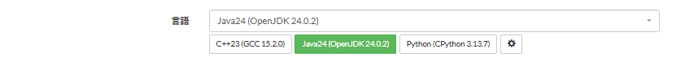

# Language switch buttons

[Back to the feature list](../../README.en.md#4-feature-list) ・ [日本語](language-buttons.md)

> Switches between your frequently used languages with buttons. Pick the languages from the gear below the language selector.

## How it works

- Adds buttons for your frequently used languages below the language selector. Pressing one switches to that language
- Pick the languages for the buttons from the gear below the selector

## Pages

- Task pages
- Submit page
- Custom test page
