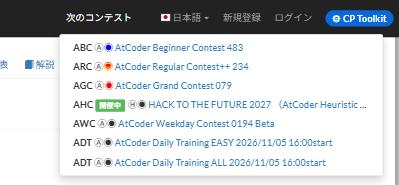

# Next contests

[Back to the feature list](../../README.en.md#4-feature-list) ・ [日本語](latest-contests.md)

> Adds a header menu with the upcoming contests listed on the home page.

## How it works

- Adds a "Next contests" menu to the header, so the upcoming contests on the home page can be opened from any page
- The list is fetched only when you open the menu and remembered for 1 hour

## Pages

- Every AtCoder page
- AtCoder top page
