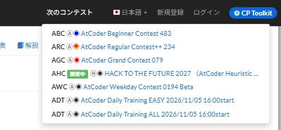

# 次のコンテスト

[機能一覧へ戻る](../../README.md#4-機能一覧) ・ [English](latest-contests.en.md)

> ホームの「次のコンテスト」の一覧を、ヘッダーのメニューから開けるようにします。

## 使い方

- ヘッダーに「次のコンテスト」のメニューを置き、ホームの「次のコンテスト」の一覧をどのページからでも開けるようにします
- メニューを開いたときだけ取得し、1時間記憶します

## 動くページ

- AtCoder のすべてのページ
- AtCoder のトップページ
