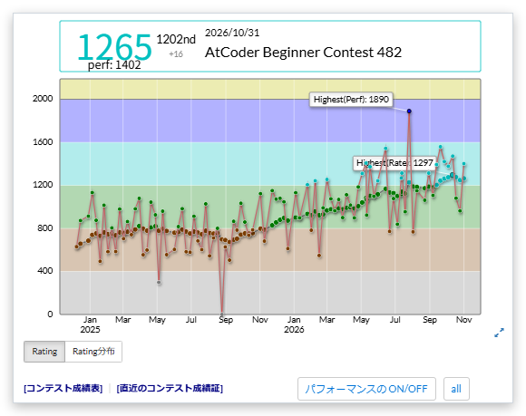

# Performance on the user page graph

[Back to the feature list](../../README.en.md#4-feature-list) ・ [日本語](rating-graph.md)

> Overlays performance on the rating graph of user pages (profiles), including other users' pages.

## How it works

- Overlays the performance of each contest on the rating graph of user pages, including other users' pages
- "Toggle performance" below the graph switches it on and off. "all" and "recent" switch between all results and recent ones
- The recent range can be a count (e.g. `20`) or a percentage (e.g. `50%`)

## Detailed settings

Change these under "Detailed settings" of each feature in the settings.

| Setting                                                                  | Default |
|--------------------------------------------------------------------------|---------|
| Show only recent results at first                                        | On      |
| Recent range (e.g. 20 for the last 20 contests, 50% for the latest half) | `20`    |

## Pages

- User pages
