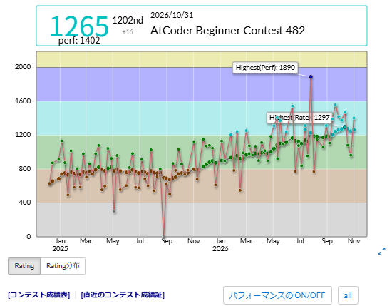

# ユーザーページのグラフへのパフォーマンス表示

[機能一覧へ戻る](../../README.md#4-機能一覧) ・ [English](rating-graph.en.md)

> ユーザーページ(プロフィール)のレーティンググラフに、パフォーマンスを重ねて表示します。自分以外のユーザーのページでも表示します。

## 使い方

- ユーザーページのレーティンググラフに、各コンテストのパフォーマンスを重ねて表示します。自分以外のユーザーのページでも表示します
- グラフの下の「パフォーマンスの ON/OFF」で表示を切り替えます。「all」と「recent」で、全期間と最近の結果を切り替えます
- 最近の範囲は、回数(例: `20`)か割合(例: `50%`)で指定できます

## 詳細設定

設定画面の各機能の「詳細設定」で変えられます。

| 項目 | 既定値 |
|---|---|
| 最初は最近の結果だけを表示する | ON |
| 最近の結果の範囲(例: 20 で直近20回、50% で直近の半分) | `20` |

## 動くページ

- ユーザーページ
