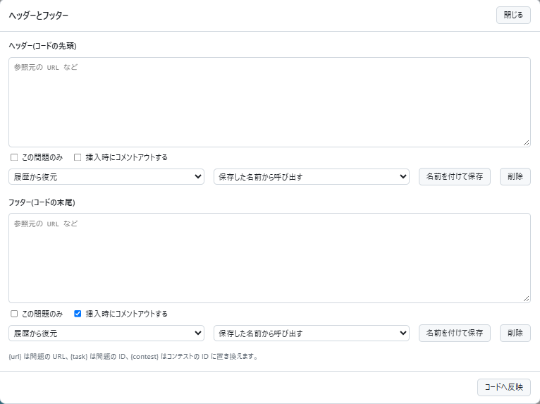

# Header and footer

[Back to the feature list](../../README.en.md#4-feature-list) ・ [日本語](source-comments.md)

> Adds a header to the top and a footer to the bottom of pasted code as comments, for example to attach reference URLs, and rewrites them when the language changes.

## How it works

- Adds comments you put in every solution, such as attached reference URLs, automatically
- Open the input screen from the "Header and footer" button to the left of the editor. The button changes color when it has content
- The header and the footer each have "Use a multi-line comment". Without it, single-line comments are used. The initial state follows "Default comment style" in the detailed settings
- When pasting replaces the whole code, the header is added to the top and the footer to the bottom. Pasting part of the code adds nothing
- The content is saved when you leave the input field and is used for the next task too. Choose "This task only" to save it for that task alone
- Saved content can be loaded with "Restore from history", which keeps the latest 20 entries. Content saved with "Save with a name" stays until you delete it
- Changing the language also switches the comment syntax. Once you edit the inserted part, it is no longer rewritten
- Without "Comment out when inserting", the text is inserted as written, so write the comment markers yourself
- `{url}`, `{task}` and `{contest}` become the task URL, the task ID and the contest ID
- For languages whose comment syntax is unknown, nothing is inserted and a notification tells you so

## Detailed settings

Change these under "Detailed settings" of each feature in the settings.

| Setting               | Default              |
|-----------------------|----------------------|
| Default comment style | Single-line comments |

## Pages

- Task pages
- Submit page
