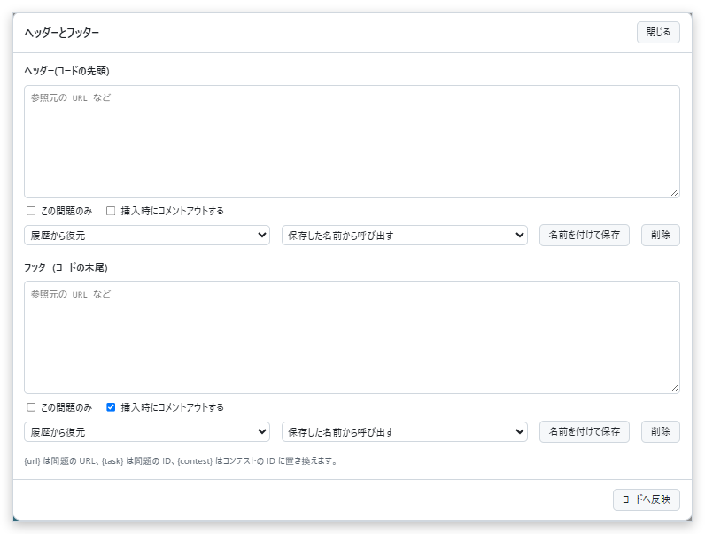

# ヘッダーとフッター

[機能一覧へ戻る](../../README.md#4-機能一覧) ・ [English](source-comments.en.md)

> 貼り付けたコードの先頭にヘッダー、末尾にフッターをコメントとして追記します。参照元の URL の添付などに使えます。言語を変えるとコメントの書き方も切り替えます。

## 使い方

- 参照元の URL の添付など、コードに毎回入れるコメントを自動で追記します
- エディタの左の「ヘッダーとフッター」のボタンから入力画面を開きます。内容があるとボタンの色が変わります
- ヘッダーとフッターのそれぞれで、「複数行コメントにする」を選べます。選ばなければ単一行コメントを並べます。最初の状態は詳細設定の「既定のコメントの形式」で決まります
- 貼り付けでコード全体が置き換わったときに、先頭へヘッダー、末尾へフッターを追記します。コードの一部の貼り付けでは追記しません
- 内容は入力欄から離れたときに保存し、次の問題でも使います。「この問題のみ」を選ぶと、その問題だけに保存します
- 保存した内容は「履歴から復元」で呼び出せます。履歴は新しい順に20件までです。「名前を付けて保存」した内容は削除するまで残ります
- 言語を変えると、コメントの書き方も切り替えます。挿入した部分を編集すると、以降は書き換えません
- 「挿入時にコメントアウトする」を外すと、書いた文字列をそのまま挿入します。この場合はコメントの記号も自分で書きます
- `{url}`、`{task}`、`{contest}` は、問題の URL、問題の ID、コンテストの ID に置き換えます
- コメントの書き方が分からない言語では挿入せず、通知で知らせます

## 詳細設定

設定画面の各機能の「詳細設定」で変えられます。

| 項目 | 既定値 |
|---|---|
| 既定のコメントの形式 | 単一行コメントを並べる |

## 動くページ

- 問題ページ
- 提出ページ
