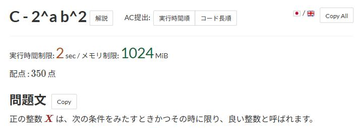

# Copy statement

[Back to the feature list](../../README.en.md#4-feature-list) ・ [日本語](statement-copy.md)

> Adds buttons that copy each section or the whole statement.

## How it works

- Adds "Copy" next to each heading such as the statement, constraints and input, and "Copy All" next to the task name
- The copy format can be Markdown or plain text

## Detailed settings

Change these under "Detailed settings" of each feature in the settings.

| Setting | Default |
|---|---|
| Copy format | Markdown |

## Pages

- Task pages
