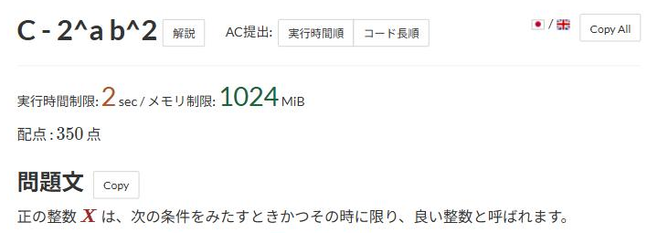

# 問題文のコピー

[機能一覧へ戻る](../../README.md#4-機能一覧) ・ [English](statement-copy.en.md)

> 問題文の各項目と全体をコピーするボタンを追加します。

## 使い方

- 問題文、制約、入力などの見出しの横に「Copy」、問題名の横に「Copy All」を置きます
- コピーする形式は Markdown とプレーンテキストから選べます

## 詳細設定

設定画面の各機能の「詳細設定」で変えられます。

| 項目 | 既定値 |
|---|---|
| コピーする形式 | Markdown |

## 動くページ

- 問題ページ
