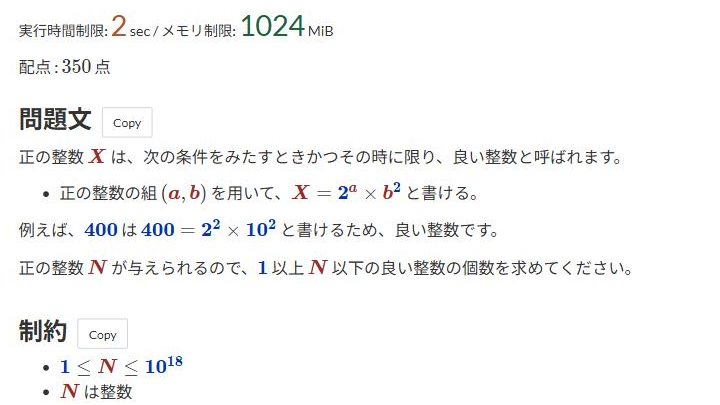

# Statement highlighting

[Back to the feature list](../../README.en.md#4-feature-list) ・ [日本語](statement-highlight.md)

> Highlights numbers, variables, and the time and memory limits.

## How it works

- Colors numbers and variables in the math of the statement
- Shows the time and memory limits in a larger font
- Each color can be changed in the detailed settings

## Detailed settings

Change these under "Detailed settings" of each feature in the settings.

| Setting | Default |
|---|---|
| Number color | `#0033b3` |
| Variable color | `#9e2927` |
| Time limit color | `#b3542a` |
| Memory limit color | `#1d643b` |

## Pages

- Task pages
