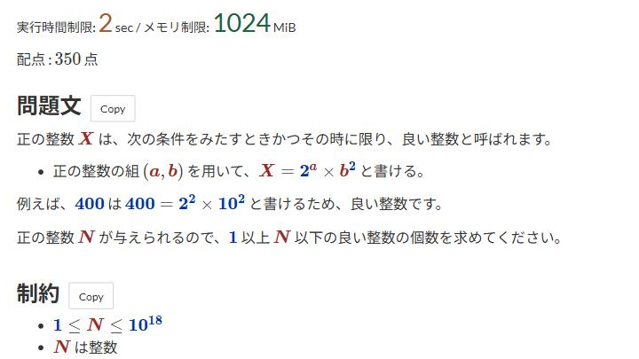

# 問題文の強調表示

[機能一覧へ戻る](../../README.md#4-機能一覧) ・ [English](statement-highlight.en.md)

> 問題文中の数字と変数、実行時間とメモリの制限を強調します。

## 使い方

- 問題文の数式の中の数字と変数に色を付けます
- 実行時間制限とメモリ制限を大きく表示します。2 秒と 1024 MiB の制限は、既定では強調しません
- 色は詳細設定で項目ごとに変えられます

## 詳細設定

設定画面の各機能の「詳細設定」で変えられます。

| 項目                             | 既定値    |
|----------------------------------|-----------|
| 数字の色                         | `#0033b3` |
| 変数の色                         | `#9e2927` |
| 実行時間制限の色                 | `#b3542a` |
| メモリ制限の色                   | `#1d643b` |
| 2 秒と 1024 MiB の制限も強調する | OFF       |

## 動くページ

- 問題ページ
