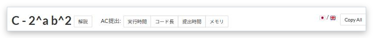

# AC submission buttons

[Back to the feature list](../../README.en.md#4-feature-list) ・ [日本語](submission-shortcuts.md)

> Adds buttons that open the AC submissions for the task, sorted by time, code size, submission time or memory. Choose the buttons to show in the detailed settings.

## How it works

- Adds "AC submissions: Time | Size | Submitted | Memory" buttons next to the task name. Each opens the AC submissions for the task in that order
- Choose the buttons to show with the checkboxes in the detailed settings. Nothing is shown when none is checked
- Setting a language in the detailed settings narrows the list to that language

## Detailed settings

Change these under "Detailed settings" of each feature in the settings.

| Setting | Default |
|---|---|
| Language (empty for all) | (empty) |
| Show the button sorted by time | On |
| Show the button sorted by code size | On |
| Show the button sorted by submission time | On |
| Show the button sorted by memory | On |

## Pages

- Task pages
