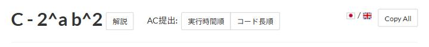

# AC 提出へのボタン

[機能一覧へ戻る](../../README.md#4-機能一覧) ・ [English](submission-shortcuts.en.md)

> 問題ページに、この問題の AC 提出を実行時間順とコード長順で開くボタンを追加します。

## 使い方

- 問題名の横に「AC提出: 実行時間順 / コード長順」のボタンを置き、この問題の AC 提出の一覧を開きます
- 詳細設定で言語を指定すると、その言語の提出だけに絞ります

## 詳細設定

設定画面の各機能の「詳細設定」で変えられます。

| 項目 | 既定値 |
|---|---|
| 言語(空欄ならすべて) | (空欄) |

## 動くページ

- 問題ページ
