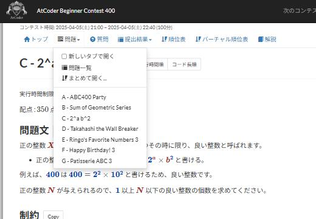

# Task dropdown

[Back to the feature list](../../README.en.md#4-feature-list) ・ [日本語](task-dropdown.md)

> Opens tasks from the Tasks tab and opens several tasks at once.

## How it works

- Turns the Tasks tab of a contest into a menu that opens each task
- Choose "Open in a new tab" to open tasks in new tabs
- "Open multiple tasks" opens all tasks or a range at once, also in reverse order
- The task list is fetched once per contest and remembered for 10 days

## Pages

- Contest pages
