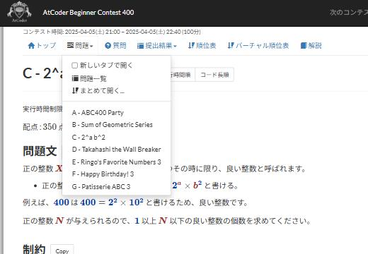

# 問題のドロップダウン

[機能一覧へ戻る](../../README.md#4-機能一覧) ・ [English](task-dropdown.en.md)

> 「問題」タブから各問題へ移動でき、複数の問題をまとめて開けます。

## 使い方

- コンテストの「問題」タブを、各問題へ移動できるメニューにします
- 「新しいタブで開く」を選ぶと、問題を新しいタブで開きます
- 「まとめて開く」で、すべての問題か指定した範囲の問題を一度に開けます。逆順でも開けます
- 問題の一覧はコンテストごとに1回取得し、10日間記憶します

## 動くページ

- コンテストのページ
