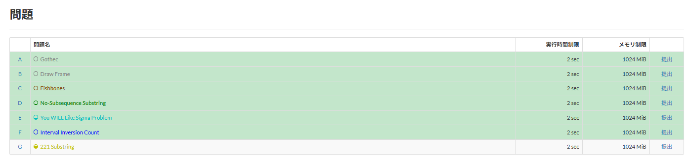

# Task status colors

[Back to the feature list](../../README.en.md#4-feature-list) ・ [日本語](task-status.md)

> Colors the task list and the dropdown by all your submissions, including those after the contest. A task with an AC or a score counts as accepted.

## How it works

- Colors the rows of the task list and the Tasks tab menu by the results of your submissions
- Your submission list is read, so submissions both during and after the contest are reflected
- A task with at least one AC or scored submission is colored as accepted, and a task with submissions but none accepted as rejected. Submissions still being judged are not counted
- Nothing is fetched while you are logged out or in the first 5 minutes of a contest

## Detailed settings

Change these under "Detailed settings" of each feature in the settings.

| Setting | Default |
|---|---|
| Color of accepted tasks | `#c3e6cb` |
| Color of tasks not accepted | `#f5c6cb` |

## Pages

- Contest pages
