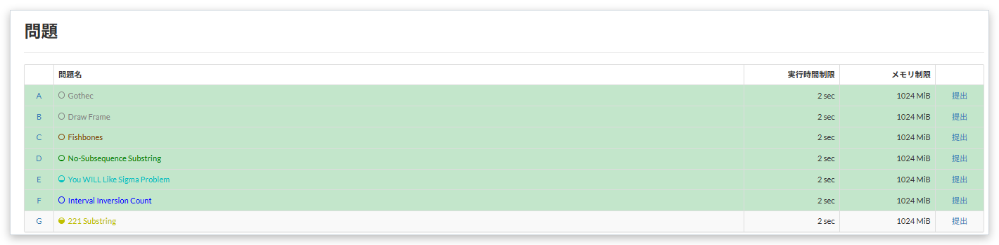

# 問題の正誤の色分け

[機能一覧へ戻る](../../README.md#4-機能一覧) ・ [English](task-status.en.md)

> 問題一覧とドロップダウンを、コンテスト後を含む自分の提出に合わせて色分けします。AC か得点があれば正解として扱います。

## 使い方

- 問題一覧の行と「問題」タブのメニューを、自分の提出の結果で色分けします
- 自分の提出一覧を読むので、コンテスト中とコンテスト後の提出をどちらも反映します
- AC か得点のある提出が1つでもあれば正解の色(既定は薄い緑)、提出があって正解がなければ不正解の色(既定は薄い赤)にします。判定中の提出は数えません
- 色は詳細設定で変えられます
- ログインしていないときと、コンテストの開始から5分の間は取得しません

## 詳細設定

設定画面の各機能の「詳細設定」で変えられます。

| 項目 | 既定値 |
|---|---|
| 正解した問題の色 | `#c3e6cb` |
| 正解していない問題の色 | `#f5c6cb` |

## 動くページ

- コンテストのページ
