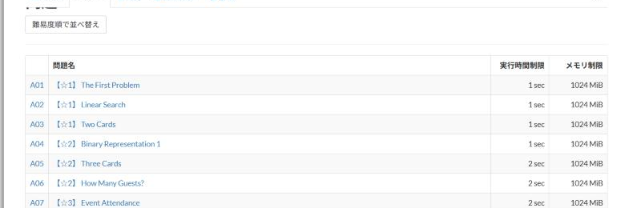

# Tessoku difficulty

[Back to the feature list](../../README.en.md#4-feature-list) ・ [日本語](tessoku-difficulty.md)

> Shows the difficulty from the book on the Tessoku task list.

## How it works

- Shows the difficulty from the book (the number of stars) before each task name on the Tessoku task list
- "Sort by difficulty" sorts the tasks by difficulty

## Pages

- Tessoku task list
