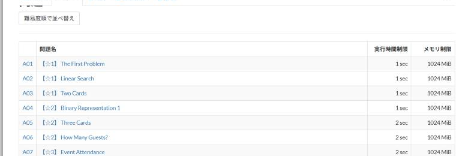

# 鉄則本の難易度表示

[機能一覧へ戻る](../../README.md#4-機能一覧) ・ [English](tessoku-difficulty.en.md)

> 「競技プログラミングの鉄則」の問題一覧に、書籍の難易度を表示します。

## 使い方

- 「競技プログラミングの鉄則」の問題一覧で、問題名の前に書籍の難易度(☆の数)を表示します
- 「難易度順で並べ替え」で、難易度の順に並べ替えられます

## 動くページ

- 鉄則本の問題一覧
