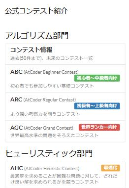

# Contest links on the top page

[Back to the feature list](../../README.en.md#4-feature-list) ・ [日本語](top-links.md)

> Replaces the top page list with links to past contests by type.

## How it works

- Replaces the official contest introduction on the top page with links to past contests by type, such as ABC, ARC, AGC and AHC

## Pages

- AtCoder top page
