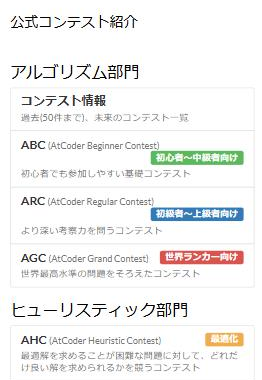

# トップページのコンテスト一覧

[機能一覧へ戻る](../../README.md#4-機能一覧) ・ [English](top-links.en.md)

> トップページの一覧を、種類ごとの過去問へのリンクに置き換えます。

## 使い方

- トップページの「公式コンテスト紹介」を、ABC、ARC、AGC、AHC などの過去のコンテスト一覧へのリンクに置き換えます

## 動くページ

- AtCoder のトップページ
