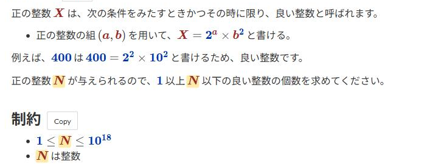

# Highlight hovered variables and numbers

[Back to the feature list](../../README.en.md#4-feature-list) ・ [日本語](variable-hover.md)

> Hovering a variable or a number in the statement highlights every occurrence. Click to pin, Esc to clear.

## How it works

- Every occurrence of the hovered variable or number in the statement is highlighted. Moving away clears it
- Click to pin the highlight. Click again or press <kbd>Esc</kbd> to clear it
- A number with an exponent, such as the "10" in "105", counts as the same number as any other "10"
- Variables and numbers can be switched separately in the detailed settings

## Detailed settings

Change these under "Detailed settings" of each feature in the settings.

| Setting | Default |
|---|---|
| Highlight variables | On |
| Highlight numbers | On |

## Pages

- Task pages
- Printable task list
