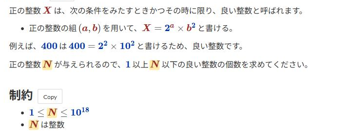

# ホバーした変数と数値の強調

[機能一覧へ戻る](../../README.md#4-機能一覧) ・ [English](variable-hover.en.md)

> 問題文の変数や数値に重ねると、同じ変数や数値をすべて強調します。クリックで固定し、Esc で解除します。

## 使い方

- 重ねた変数や数値と同じものを、問題文の中ですべて強調します。離れると強調を消します
- クリックすると強調を固定します。もう一度クリックするか、<kbd>Esc</kbd> で解除します
- 「998244353」や「109」のような数値は、1つのまとまりとして扱います。指数の付く数値は、指数まで同じものだけを強調します
- 変数と数値は、詳細設定で別々に ON/OFF できます

## 詳細設定

設定画面の各機能の「詳細設定」で変えられます。

| 項目 | 既定値 |
|---|---|
| 変数を強調する | ON |
| 数値を強調する | ON |

## 動くページ

- 問題ページ
- 問題の一括表示(印刷用)のページ
